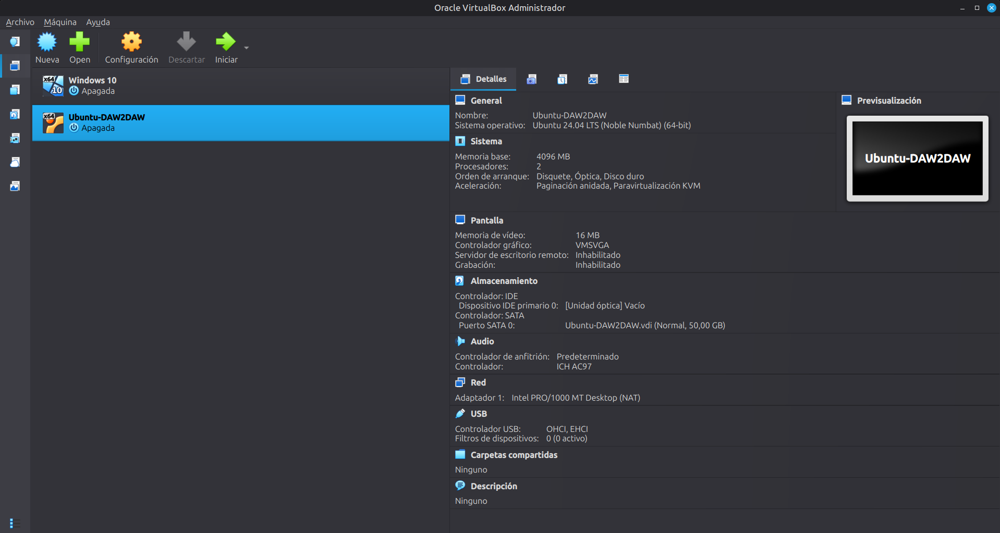
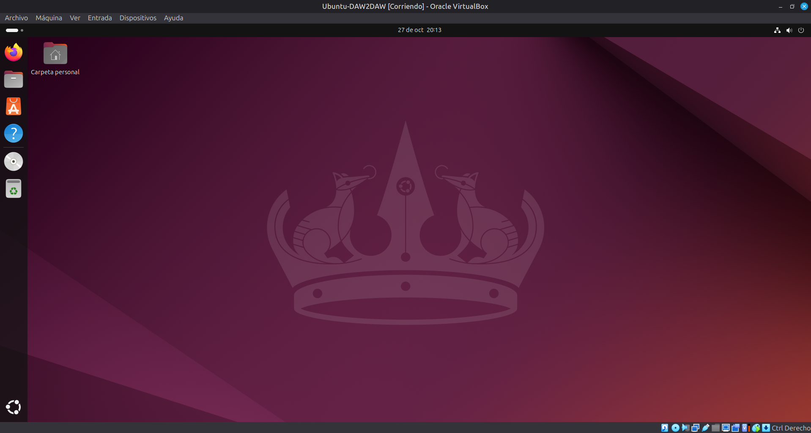
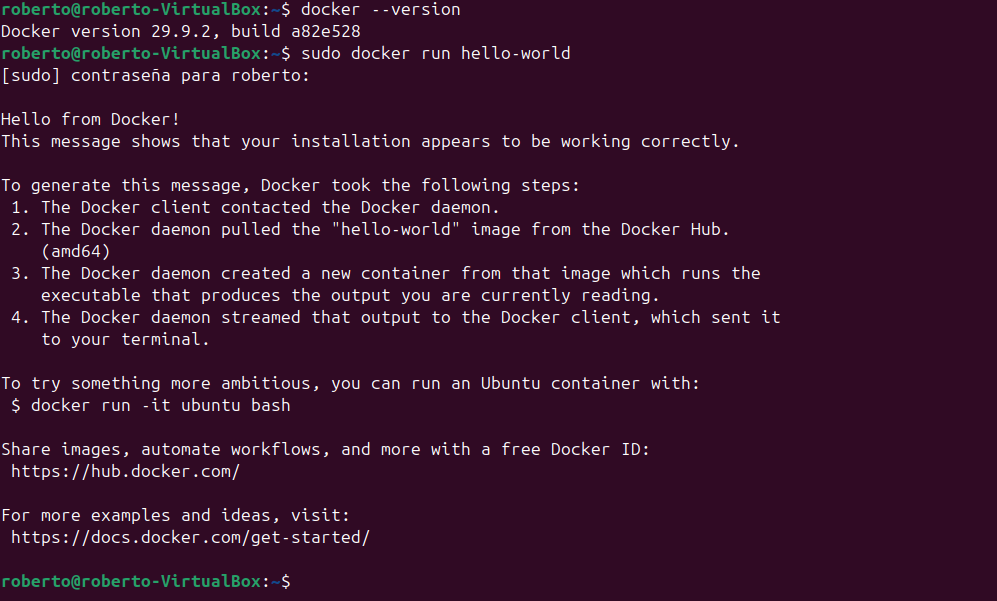
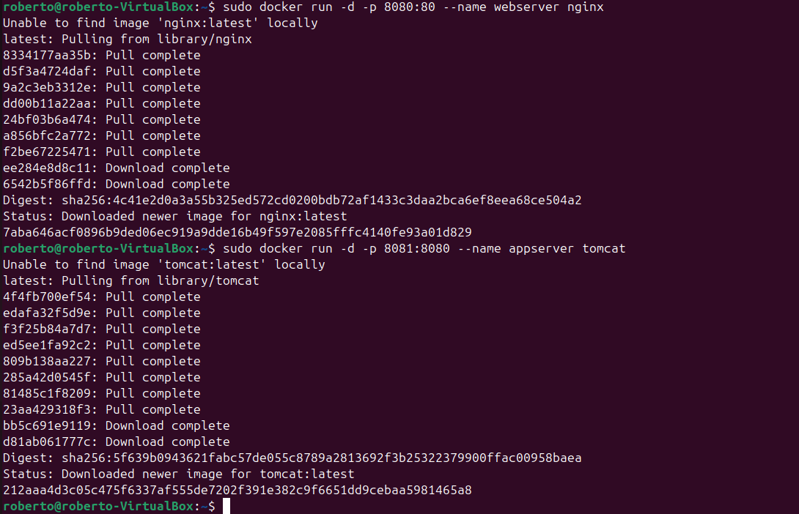
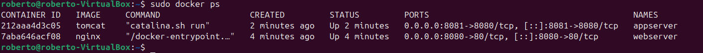
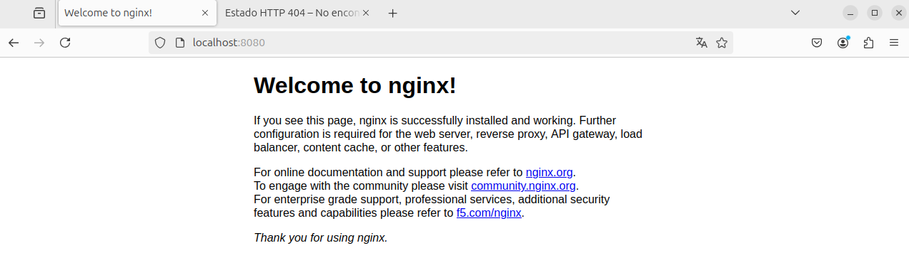
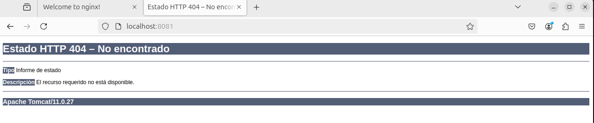

# Iniciación a la Virtualización

- **Alumno:** *Roberto Martín*
- **Curso:** *2º DAW*
- **Centro:** *IES Juan Bosco*

---

## Índice

1. [Introducción a la virtualización](#1-introducción-a-la-virtualización)
2. [Instalación de Ubuntu en VirtualBox](#2-instalación-de-ubuntu-en-virtualbox)
3. [Instalación de Docker Desktop en Ubuntu](#3-instalación-de-docker-desktop-en-ubuntu)
4. [Contenedores de servidor web y de aplicaciones](#4-contenedores-de-servidor-web-y-de-aplicaciones)
5. [Requerimientos mínimos para implantar una aplicación web](#5-requerimientos-mínimos-para-implantar-una-aplicación-web)

---

## 1. Introducción a la virtualización

La **virtualización** es una tecnología que permite ejecutar varios sistemas operativos o entornos de software independientes en una misma máquina física, mediante el uso de **hipervisores** (VirtualBox, VMware, Hyper-V, etc.). Cada entorno virtual se denomina **máquina virtual (VM)**.

**Conceptos clave:**

| Concepto | Descripción |
|---|---|
| **Hipervisor** | Software que crea y gestiona las máquinas virtuales. |
| **Imagen ISO** | Archivo que contiene una copia exacta de un sistema operativo o software de instalación. |
| **Recursos virtualizados** | CPU, memoria RAM, almacenamiento y red. |

---

## 2. Instalación de Ubuntu en VirtualBox

### 2.1. Descarga de la ISO

Se descargó la imagen ISO de **Ubuntu 24.04 LTS (Noble Numbat)** desde la página oficial de Ubuntu (<https://ubuntu.com>).

### 2.2. Creación de la máquina virtual

Se creó una nueva máquina virtual en VirtualBox con las siguientes características:

| Parámetro | Valor |
|---|---|
| Nombre | `Ubuntu-DAW2DAW` |
| Tipo / Versión | Linux / Ubuntu (64-bit) |
| Memoria RAM | 4096 MB |
| Disco duro virtual | 50 GB (VDI, tamaño dinámico) |
| Tipo de red | NAT |
| CPUs | 2 |

Pasos seguidos:

1. En VirtualBox, pulsar **Nueva**.
2. Indicar el nombre `Ubuntu-DAW2DAW` y seleccionar la ISO descargada.
3. Asignar 4096 MB de RAM.
4. Crear un disco duro virtual de 50 GB.
5. Comprobar en **Configuración → Red** que el adaptador 1 está en modo **NAT**.
6. Iniciar la máquina e instalar Ubuntu siguiendo el asistente (idioma, teclado, usuario y contraseña, particionado automático).
7. Al terminar, reiniciar y retirar la ISO.



### 2.3. Instalación de las Guest Additions

Las **Guest Additions** mejoran la integración entre el sistema anfitrión y el invitado (resolución de pantalla dinámica, portapapeles compartido, carpetas compartidas, mejor rendimiento gráfico).

Pasos seguidos (desde la VM Ubuntu):

1. Instalar los paquetes necesarios para compilar los módulos:

   ```bash
   sudo apt update
   sudo apt install build-essential dkms linux-headers-$(uname -r) -y
   ```

2. En el menú de VirtualBox: **Dispositivos → Insertar imagen de CD de los Guest Additions…**
3. Ejecutar el instalador desde el CD montado:

   ```bash
   cd /media/$USER/VBox_GAs_*
   sudo ./VBoxLinuxAdditions.run
   ```

4. Reiniciar la máquina virtual:

   ```bash
   sudo reboot
   ```



---

## 3. Instalación de Docker Desktop en Ubuntu

### 3.1. Teoría básica sobre contenedores

Un **contenedor** es una unidad de software que empaqueta el código, las dependencias y las configuraciones necesarias para ejecutar una aplicación. A diferencia de una máquina virtual, los contenedores **comparten el kernel del sistema operativo anfitrión**, lo que los hace más ligeros y rápidos.

| | Máquina virtual | Contenedor |
|---|---|---|
| Sistema operativo | Uno completo por VM | Comparten el kernel del host |
| Tamaño | GB | MB |
| Arranque | Minutos | Segundos |
| Aislamiento | Total (hardware virtual) | A nivel de procesos |

**Ventajas de Docker:**

- **Portabilidad:** la misma imagen funciona igual en cualquier equipo con Docker.
- **Aislamiento:** cada aplicación vive en su propio entorno sin interferir con las demás.
- **Escalabilidad:** es sencillo crear múltiples réplicas de un mismo servicio.
- **Rapidez de despliegue:** una aplicación se descarga y se ejecuta con un solo comando.

### 3.2. Instalación paso a paso

**1) Actualizar los repositorios y el sistema:**

```bash
sudo apt update && sudo apt upgrade -y
```

**2) Instalar dependencias:**

```bash
sudo apt install ca-certificates curl gnupg -y
```

**3) Añadir el repositorio oficial de Docker:**

```bash
sudo install -m 0755 -d /etc/apt/keyrings
sudo curl -fsSL https://download.docker.com/linux/ubuntu/gpg -o /etc/apt/keyrings/docker.asc
sudo chmod a+r /etc/apt/keyrings/docker.asc

echo "deb [arch=$(dpkg --print-architecture) signed-by=/etc/apt/keyrings/docker.asc] https://download.docker.com/linux/ubuntu $(. /etc/os-release && echo "${UBUNTU_CODENAME:-$VERSION_CODENAME}") stable" | sudo tee /etc/apt/sources.list.d/docker.list > /dev/null

sudo apt update
```

**4) Descargar e instalar Docker Desktop:**

```bash
wget https://desktop.docker.com/linux/main/amd64/docker-desktop-amd64.deb

sudo apt install ./docker-desktop-amd64.deb
```

**5) Iniciar Docker Desktop:**

```bash
systemctl --user start docker-desktop
```

Alternativa (solo si Docker Desktop no arranca):

```bash
curl -fsSL https://get.docker.com | sudo sh
```

### 3.3. Verificación del funcionamiento

```bash
docker --version
sudo docker run hello-world
```

El contenedor `hello-world` descarga una imagen mínima y muestra un mensaje confirmando que Docker funciona correctamente.



---

## 4. Contenedores de servidor web y de aplicaciones

### 4.1. Conceptos

- **Servidor web:** Atiende peticiones HTTP/HTTPS (ej. Nginx, Apache).
- **Servidor de aplicaciones:** Ejecuta la lógica de negocio (ej. Tomcat, WildFly).

### 4.2. Búsqueda de imágenes disponibles

```bash
sudo docker search nginx
sudo docker search tomcat
```

### 4.3. Descarga y arranque de los contenedores

```bash
sudo docker run -d -p 8080:80 --name webserver nginx
sudo docker run -d -p 8081:8080 --name appserver tomcat
```

Explicación de los parámetros:

| Parámetro | Significado |
|---|---|
| `run` | Crea y arranca un contenedor a partir de una imagen. |
| `-d` | Modo *detached*: se ejecuta en segundo plano. |
| `-p 8080:80` | Mapea el puerto **8080 del anfitrión** al **80 del contenedor** (formato `host:contenedor`). |
| `--name` | Asigna un nombre al contenedor. |
| `nginx` / `tomcat` | Imagen que se descarga de Docker Hub si no existe en local. |



### 4.4. Verificación de contenedores activos

```bash
sudo docker ps
```



### 4.5. Pruebas desde el navegador

| Servicio | URL |
|---|---|
| Nginx | <http://localhost:8080> |
| Tomcat | <http://localhost:8081> |

**Nginx:** debe mostrarse la página *"Welcome to nginx!"*.



**Tomcat:** en las imágenes actuales de Tomcat la carpeta `webapps` viene vacía, por lo que el navegador puede mostrar una página de **error 404 de Apache Tomcat**. Eso confirma que el servidor está funcionando.



---

## 5. Requerimientos mínimos para implantar una aplicación web

### 5.1. Requisitos de hardware y software

**Hardware (mínimo orientativo para un entorno pequeño/de pruebas):**

| Recurso | Mínimo recomendado | Comentario |
|---|---|---|
| CPU | 2 núcleos | Más núcleos si hay muchas peticiones concurrentes o hay base de datos en el mismo servidor. |
| RAM | 4 GB | Tomcat (JVM) es el componente que más memoria consume; Nginx consume muy poco. |
| Almacenamiento | 20–50 GB (preferible SSD) | Sistema, aplicación, logs, imágenes de contenedores y datos. |
| Red | 100 Mbps – 1 Gbps | Según el tráfico esperado. |

**Software:**

- **Sistema operativo** del servidor: Linux (Ubuntu Server LTS, Debian…) o Windows Server.
- **Servidor web:** Nginx o Apache HTTP Server.
- **Servidor de aplicaciones:** Tomcat, WildFly u otro, según la tecnología de la aplicación.
- **Entorno de ejecución:** JDK/JRE (Java), PHP, Node.js, Python… según el lenguaje.
- **Sistema gestor de base de datos** (MySQL/MariaDB, PostgreSQL…), si la aplicación lo necesita.
- **Plataforma de contenedores/virtualización:** Docker, VirtualBox u otro hipervisor.
- **Herramientas auxiliares:** cliente SSH, Git, herramientas de monitorización y copias de seguridad.

### 5.2. Infraestructura de red

- **Dirección IP** fija para el servidor y, normalmente, un **nombre de dominio** gestionado por **DNS**.
- **Puertos** que deben estar abiertos:

  | Puerto | Servicio |
  |---|---|
  | 80 | HTTP |
  | 443 | HTTPS |
  | 22 | SSH (administración, restringido) |
  | 8080 / 8081 (en esta práctica) | Nginx / Tomcat mapeados desde Docker |

- **Cortafuegos** (firewall) que solo permita el tráfico necesario.
- **Modos de red de VirtualBox:** en esta práctica se usa **NAT** (la VM sale a Internet pero no es accesible desde fuera). Para acceder a la VM desde otros equipos se usaría **adaptador puente** o **reenvío de puertos**.
- En entornos reales: **proxy inverso / balanceador de carga** delante de los servidores de aplicaciones y, si procede, una **DMZ** que aísle los servidores públicos de la red interna.

### 5.3. Configuración del servidor web y de aplicaciones

**Servidor web (Nginx):**

- Archivo de configuración principal: `/etc/nginx/nginx.conf` y sitios en `/etc/nginx/conf.d/`.
- Directorio de contenido por defecto: `/usr/share/nginx/html`.
- Configuración de *virtual hosts* (varios sitios en un mismo servidor), compresión, caché y certificados TLS.
- Puede actuar como **proxy inverso** hacia Tomcat:

  ```nginx
  server {
      listen 80;
      server_name midominio.local;

      location / {
          proxy_pass http://appserver:8080;
      }
  }
  ```

**Servidor de aplicaciones (Tomcat):**

- Directorio de aplicaciones: `webapps/` (se despliegan archivos `.war`).
- Archivos de configuración en `conf/`: `server.xml` (puertos, conectores), `web.xml`, `tomcat-users.xml` (usuarios del gestor).
- Parámetros de la JVM (memoria `-Xms` / `-Xmx`) ajustados a los recursos disponibles.
- Registros en `logs/`.

**Con Docker**, la configuración persistente se gestiona mediante **volúmenes** (`-v`) y la comunicación entre contenedores con **redes Docker** o *Docker Compose*.

### 5.4. Seguridad y mantenimiento

**Seguridad:**

- Mantener el sistema, Docker y las imágenes **actualizados** (parches de seguridad).
- Usar **HTTPS** con certificados TLS válidos (por ejemplo, Let's Encrypt).
- Configurar un **cortafuegos** (UFW, iptables) y exponer solo los puertos necesarios.
- Aplicar el **principio de mínimo privilegio**: no ejecutar servicios como root, usuarios con permisos limitados.
- Cambiar credenciales por defecto y eliminar aplicaciones de ejemplo o gestores innecesarios (p. ej., el *manager* de Tomcat).
- Ocultar versiones del servidor en cabeceras y páginas de error.
- Usar imágenes oficiales y de confianza; escanearlas en busca de vulnerabilidades.
- Acceso remoto mediante **SSH con clave** en lugar de contraseña.

**Mantenimiento:**

- **Copias de seguridad** periódicas de datos, configuración y volúmenes, y comprobación de que se pueden restaurar.
- **Monitorización** de CPU, RAM, disco y disponibilidad del servicio.
- Revisión y **rotación de logs** (`docker logs`, `logrotate`).
- Limpieza de recursos no usados: `docker system prune`.
- Documentar la configuración y los cambios realizados.
- Plan de recuperación ante fallos (reiniciar contenedores con `--restart unless-stopped`, snapshots de la VM).