# Implementación de HTTPS en un servidor Apache2 sobre Ubuntu

- **Nombre:** Roberto Martín
- **Curso:** 2º DAW
- **Centro:** IES Juan Bosco

---

## Resumen

Esta memoria recoge la investigación y la implementación del protocolo HTTPS en un servidor Apache2 sobre Ubuntu 24.04 LTS. En la parte teórica se explica el funcionamiento de TLS, la diferencia entre los certificados autofirmados y los emitidos por una autoridad de certificación, y los módulos de Apache necesarios para habilitarlo. En la parte práctica se activan los módulos `ssl` y `headers`, se genera un certificado autofirmado con OpenSSL, se configura un VirtualHost en el puerto 443 con cabeceras de seguridad y se redirige el tráfico HTTP a HTTPS. El acceso seguro se verifica mediante navegador, `curl` y `openssl`.

## Palabras clave

HTTPS · TLS · SSL · Apache2 · certificado autofirmado · OpenSSL · VirtualHost · puerto 443 · redirección · Let's Encrypt

---

## Índice

1. [Introducción](#1-introducción)
2. [Investigación teórica](#2-investigación-teórica)
3. [Implementación paso a paso](#3-implementación-paso-a-paso)
4. [Banco de pruebas](#4-banco-de-pruebas)
5. [Problemas surgidos y soluciones](#5-problemas-surgidos-y-soluciones)
6. [Resultados](#6-resultados)
7. [Conclusión](#7-conclusión)
8. [Bibliografía](#8-bibliografía)
9. [Anexos](#9-anexos)

---

## 1. Introducción

### 1.1 Contexto

Esta práctica continúa el trabajo realizado con Apache en la práctica anterior. Se parte de la máquina virtual **Ubuntu-DAW2DAW**, que ya tiene instalado Apache 2.4.58 y un sitio personalizado publicado en `http://gci.example.com` mediante un VirtualHost, con dos zonas protegidas: `/privado/` (autenticación básica) e `/interno/` (restricción por IP).

| Elemento | Descripción |
|---|---|
| Hipervisor | Oracle VirtualBox |
| Sistema operativo | Ubuntu 24.04 LTS (Noble Numbat) |
| Servidor web | Apache HTTP Server 2.4.58 (paquete `apache2`) |
| Sitio de partida | `gci.example.com` (`DocumentRoot /var/www/gci`) |
| Resolución de nombres | Entrada en `/etc/hosts` (`127.0.0.1 gci.example.com`) |

### 1.2 Objetivos

- Investigar el funcionamiento de HTTPS, los tipos de certificados y los módulos de Apache necesarios.
- Habilitar los módulos `ssl` y `headers`.
- Generar un certificado SSL/TLS.
- Configurar un VirtualHost en el puerto 443.
- Redirigir el tráfico HTTP a HTTPS.
- Validar el acceso seguro mediante navegador y `curl`.

---

## 2. Investigación teórica

### 2.1 Funcionamiento de HTTPS y su importancia

**HTTPS** (*HTTP Secure*) es el protocolo HTTP transportado sobre una capa de cifrado **TLS** (*Transport Layer Security*), normalmente en el puerto **443**. TLS es el sucesor de SSL: las versiones SSL 2.0 y 3.0 están abandonadas, y hoy se utilizan TLS 1.2 y TLS 1.3 [5][6]. Por costumbre se sigue hablando de «certificado SSL», aunque el protocolo real sea TLS.

TLS ofrece tres garantías:

| Garantía | Qué significa | Cómo se consigue |
|---|---|---|
| **Confidencialidad** | Nadie en el camino puede leer los datos. | Cifrado simétrico de la sesión (por ejemplo, AES-GCM o ChaCha20-Poly1305). |
| **Integridad** | Los datos no pueden modificarse sin que se detecte. | Códigos de autenticación incluidos en el cifrado. |
| **Autenticación** | El cliente comprueba que habla con el servidor legítimo. | Certificado digital X.509 firmado por una autoridad de certificación. |

**Establecimiento de la conexión (*handshake*), versión simplificada de TLS 1.3:**

```
Cliente (navegador)                                    Servidor (Apache)
      |                                                       |
      | ---- 1. ClientHello (versiones, suites, clave) -----> |
      | <--- 2. ServerHello (suite elegida, clave) ---------- |
      | <--- 3. Certificado + firma + Finished -------------- |
      |         (el cliente valida el certificado)            |
      | ---- 4. Finished -----------------------------------> |
      | ==== 5. Datos HTTP cifrados con la clave de sesión == |
```

1. El cliente propone las versiones y suites de cifrado que admite y aporta su parte de un intercambio de claves.
2. El servidor elige la suite y aporta su parte del intercambio de claves. Con ambas partes se calcula una **clave de sesión** que nunca viaja por la red.
3. El servidor envía su **certificado** y demuestra que posee la clave privada correspondiente.
4. El cliente **valida** el certificado: que esté firmado por una autoridad en la que confía, que no haya caducado y que el nombre del sitio coincida con el que contiene el certificado.
5. A partir de ahí, todo el tráfico HTTP viaja cifrado con la clave de sesión.

El intercambio de claves es efímero, por lo que, aunque en el futuro se robase la clave privada del servidor, no se podrían descifrar las sesiones pasadas (*forward secrecy*) [6].

**Importancia en la seguridad web:**

- Evita que se **espíen** contraseñas, cookies y datos personales en redes no confiables (Wi-Fi públicas, por ejemplo).
- Evita que se **manipule** el contenido en tránsito (inyección de anuncios o de código malicioso).
- Evita la **suplantación** del sitio (*man-in-the-middle*).
- Es imprescindible en la práctica anterior: la autenticación básica de `/privado/` envía el usuario y la contraseña sin cifrar si no se usa HTTPS.
- Los navegadores marcan como «No seguro» los sitios HTTP, y funciones como HTTP/2 o las cookies con atributo `Secure` requieren HTTPS.
- Ayuda a cumplir las normativas de protección de datos, como el RGPD.

| | HTTP | HTTPS |
|---|---|---|
| Puerto habitual | 80 | 443 |
| Cifrado | No | Sí (TLS) |
| Identidad del servidor | No verificada | Verificada con certificado |
| Integridad | No garantizada | Garantizada |
| Aviso del navegador | «No seguro» | Candado (si el certificado es de confianza) |

### 2.2 Tipos de certificados SSL/TLS

Un **certificado X.509** es un documento digital que contiene la clave pública del servidor, el nombre (o nombres) para los que es válido, las fechas de validez y la **firma** de quien lo emite. Los navegadores confían en una lista de **autoridades de certificación (CA) raíz**, normalmente el certificado del servidor está firmado por una CA intermedia, que a su vez está firmada por una raíz (*cadena de confianza*).

| | Autofirmado | Emitido por una CA de confianza |
|---|---|---|
| **Quién lo firma** | El propio servidor, con su propia clave. | Una autoridad de certificación reconocida. |
| **Confianza del navegador** | Ninguna: muestra un aviso de seguridad. | Total: muestra el candado. |
| **Coste** | Gratuito. | Gratuito (Let's Encrypt) o de pago (CA comerciales). |
| **Validez típica** | La que se elija. | Limitada (90 días en Let's Encrypt) [8]. |
| **Requisitos** | Ninguno. | Demostrar el control del dominio. |
| **Uso recomendado** | Pruebas, laboratorios, redes internas. | Sitios públicos y en producción. |
| **Riesgo** | Habituar al usuario a ignorar avisos. | Depende de la gestión de la clave privada y de la renovación. |

**Niveles de validación de las CA:**

- **DV (*Domain Validation*):** solo comprueba que quien lo solicita controla el dominio. Es el caso de Let's Encrypt.
- **OV (*Organization Validation*):** además verifica la existencia de la organización.
- **EV (*Extended Validation*):** validación más exhaustiva de la organización.

**Por alcance**, un certificado puede cubrir un único nombre, varios nombres (campo SAN, *Subject Alternative Name*) o un dominio y todos sus subdominios (*wildcard*, `*.ejemplo.org`).

**Let's Encrypt** es una CA gratuita y automatizada, que emite certificados DV mediante el protocolo ACME. Sus certificados duran 90 días por defecto, por lo que la renovación debe automatizarse (Certbot lo hace con un temporizador del sistema) [9].

### 2.3 Módulos de Apache2 necesarios en Ubuntu

| Módulo | Función | Necesario | Activación |
|---|---|---|---|
| `ssl` (`mod_ssl`) | Añade a Apache soporte SSL/TLS apoyándose en OpenSSL [1][2]. | Obligatorio | `sudo a2enmod ssl` |
| `headers` (`mod_headers`) | Permite añadir, modificar o eliminar cabeceras HTTP, por ejemplo las de seguridad [3]. | Requerido en la práctica | `sudo a2enmod headers` |
| `alias` (`mod_alias`) | Proporciona la directiva `Redirect` [4]. | Para la redirección (ya viene activo) | — |
| `rewrite` (`mod_rewrite`) | Reescritura de URL, alternativa a `Redirect` con condiciones. | Opcional | `sudo a2enmod rewrite` |
| `socache_shmcb` | Caché de sesiones TLS en memoria compartida. | Dependencia de `ssl` | Se activa automáticamente con `ssl` |

**Otros elementos que intervienen:**

- **OpenSSL:** herramienta para generar claves y certificados.
- **`/etc/apache2/ports.conf`:** al activar `ssl`, Apache empieza a escuchar también en el puerto 443.
- **`/etc/apache2/sites-available/default-ssl.conf`:** plantilla de VirtualHost HTTPS incluida en Ubuntu (no se usa, se crea uno propio).
- **Certbot** y su plugin de Apache: solo para la Opción B.

**Directivas principales de un VirtualHost HTTPS:**

| Directiva | Función |
|---|---|
| `SSLEngine on` | Activa TLS en ese VirtualHost. |
| `SSLCertificateFile` | Ruta del certificado (clave pública). |
| `SSLCertificateKeyFile` | Ruta de la clave privada. |
| `SSLProtocol` | Versiones de TLS permitidas. |
| `Header always set ...` | Añade cabeceras de seguridad a las respuestas. |

---

## 3. Implementación paso a paso

### 3.1 Instalación y verificación de Apache2

Se comprueba que está actualizado y funcionando:

```bash
sudo apt update
sudo apt install apache2
systemctl status apache2 --no-pager
apache2 -v
```

Si el paquete ya está instalado, `apt` indica que está en su versión más reciente.

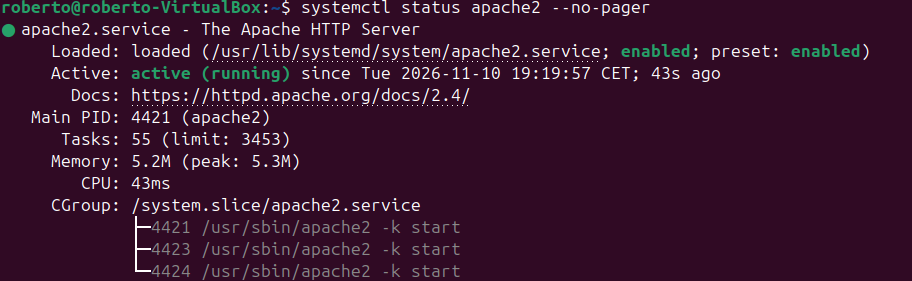

### 3.2 Habilitación de los módulos SSL y headers

```bash
sudo a2enmod ssl headers
sudo systemctl restart apache2
apache2ctl -M | grep -E 'ssl|headers'
```

Es necesario **reiniciar** (no basta con recargar), porque se han cargado módulos nuevos y Apache debe empezar a escuchar en el puerto 443. La última orden debe mostrar `ssl_module` y `headers_module`.

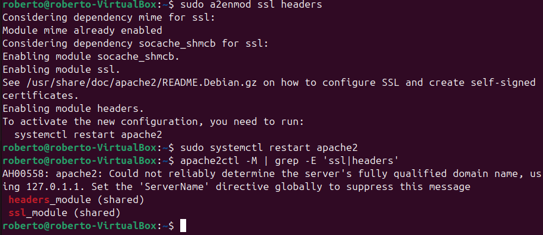

### 3.3 Generación del certificado

#### Opción A: certificado autofirmado (ejecutada)

```bash
sudo openssl req -x509 -nodes -days 365 -newkey rsa:2048 \
  -keyout /etc/ssl/private/gci-selfsigned.key \
  -out /etc/ssl/certs/gci-selfsigned.crt \
  -subj "/C=ES/ST=[PROVINCIA]/L=[LOCALIDAD]/O=IES Juan Bosco/CN=gci.example.com" \
  -addext "subjectAltName=DNS:gci.example.com"
sudo chmod 600 /etc/ssl/private/gci-selfsigned.key
```

> *Hay que cambiar `[PROVINCIA]` y `[LOCALIDAD]` antes de ejecutar el comando.*

| Parámetro | Significado |
|---|---|
| `req -x509` | Genera directamente un certificado autofirmado en lugar de una solicitud de firma. |
| `-nodes` | La clave privada no se cifra con contraseña (Apache podrá arrancar sin intervención). |
| `-days 365` | Validez de un año. |
| `-newkey rsa:2048` | Crea una clave RSA nueva de 2048 bits. |
| `-keyout` / `-out` | Rutas de la clave privada y del certificado. |
| `-subj` | Datos del titular, `CN` es el nombre del sitio. |
| `-addext "subjectAltName=..."` | Añade el nombre en el campo SAN, que es el que validan los navegadores actuales. |

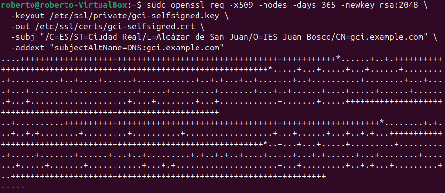

Se comprueban los datos del certificado y los permisos de la clave:

```bash
openssl x509 -in /etc/ssl/certs/gci-selfsigned.crt -noout -subject -issuer -dates -ext subjectAltName
sudo ls -l /etc/ssl/private/gci-selfsigned.key
```

El emisor (*issuer*) coincide con el titular (*subject*), lo que confirma que es autofirmado. La clave privada solo debe ser legible por root (`-rw-------`).

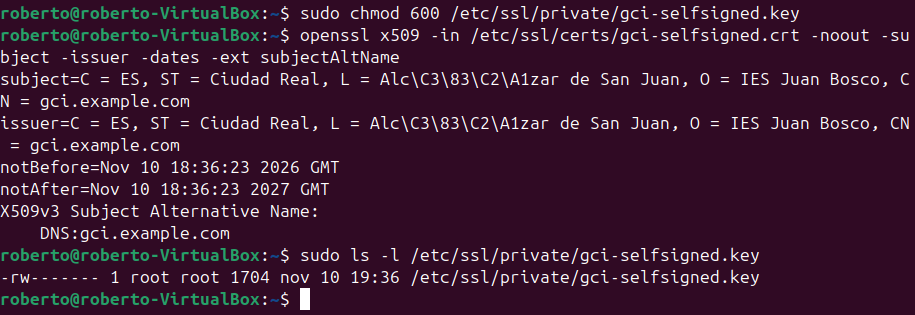

### 3.4 Configuración del VirtualHost en el puerto 443

Se crea el fichero `/etc/apache2/sites-available/gci-ssl.conf`:

```bash
sudo nano /etc/apache2/sites-available/gci-ssl.conf
```

```apache
<VirtualHost *:443>
    ServerAdmin webmaster@localhost
    ServerName gci.example.com
    DocumentRoot /var/www/gci

    # --- TLS ---
    SSLEngine on
    SSLCertificateFile    /etc/ssl/certs/gci-selfsigned.crt
    SSLCertificateKeyFile /etc/ssl/private/gci-selfsigned.key
    SSLProtocol -all +TLSv1.2 +TLSv1.3

    # --- Cabeceras de seguridad (mod_headers) ---
    Header always set X-Content-Type-Options "nosniff"
    Header always set X-Frame-Options "SAMEORIGIN"
    Header always set Referrer-Policy "strict-origin-when-cross-origin"

    ErrorLog ${APACHE_LOG_DIR}/gci_ssl_error.log
    CustomLog ${APACHE_LOG_DIR}/gci_ssl_access.log combined

    <Directory /var/www/gci>
        Require all granted
    </Directory>

    # --- Zonas protegidas ---
    <Directory /var/www/gci/privado>
        AuthType Basic
        AuthName "Zona privada"
        AuthBasicProvider file
        AuthUserFile /etc/apache2/.htpasswd
        Require valid-user
    </Directory>

    <Directory /var/www/gci/interno>
        Require ip 127.0.0.1 ::1
    </Directory>
</VirtualHost>
```

| Directiva | Función | Valor |
|---|---|---|
| `<VirtualHost *:443>` | Atiende las conexiones al puerto HTTPS. | Puerto 443 |
| `SSLEngine on` | Activa TLS para este sitio. | `on` |
| `SSLCertificateFile` | Certificado generado en el paso 3.3. | `/etc/ssl/certs/gci-selfsigned.crt` |
| `SSLCertificateKeyFile` | Clave privada del certificado. | `/etc/ssl/private/gci-selfsigned.key` |
| `SSLProtocol` | Solo permite TLS 1.2 y 1.3. | `-all +TLSv1.2 +TLSv1.3` |
| `Header always set` | Añade cabeceras de seguridad a todas las respuestas. | `nosniff`, `SAMEORIGIN`, `Referrer-Policy` |

Se activa el sitio:

```bash
sudo a2ensite gci-ssl.conf
systemctl reload apache2
```
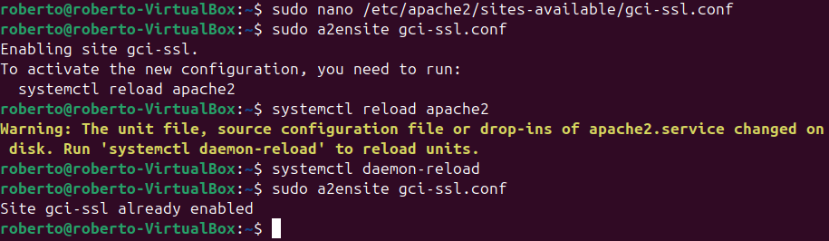

### 3.5 Redirección de HTTP a HTTPS

Se edita el VirtualHost del puerto 80 (`gci.conf`) para que redirija todo el tráfico al sitio seguro. Los bloques `<Directory>` de las zonas protegidas se eliminan de este fichero, porque ya están en `gci-ssl.conf` y en el puerto 80 ninguna petición llega a servirse:

```bash
sudo nano /etc/apache2/sites-available/gci.conf
```

```apache
<VirtualHost *:80>
    ServerAdmin webmaster@localhost
    ServerName gci.example.com
    DocumentRoot /var/www/gci

    # Redirige todo el tráfico HTTP a HTTPS conservando la ruta
    Redirect permanent / https://gci.example.com/

    ErrorLog ${APACHE_LOG_DIR}/gci_error.log
    CustomLog ${APACHE_LOG_DIR}/gci_access.log combined
</VirtualHost>
```

- `Redirect permanent` (mod_alias) responde con un **301** y la nueva dirección [4]. La ruta solicitada se conserva: `/privado/` se redirige a `https://gci.example.com/privado/`.
- Los navegadores **guardan en caché** las redirecciones 301. Durante las pruebas se puede usar `Redirect / https://gci.example.com/` (código 302) y cambiar a `permanent` al final.
- La redirección va **solo** en el VirtualHost del puerto 80. Si se pusiera también en el 443, se produciría un bucle infinito de redirecciones.

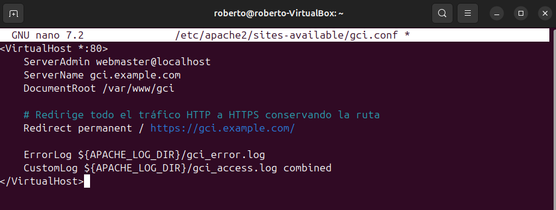

### 3.6 Validación y reinicio de Apache

```bash
sudo apache2ctl configtest
sudo systemctl restart apache2
sudo ss -tlnp | grep -E ':(80|443)\s'
```

`configtest` debe devolver `Syntax OK`, y `ss` debe mostrar a `apache2` escuchando en los puertos **80 y 443**.

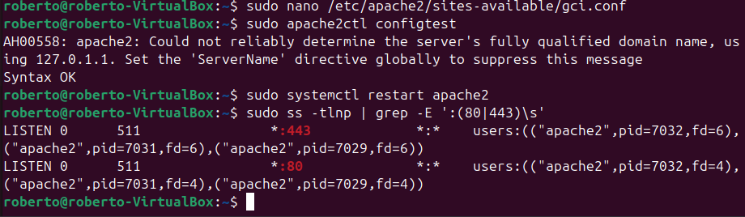

### 3.7 Verificación del acceso seguro

#### Con el navegador

1. Abrir `https://gci.example.com`. Al ser un certificado autofirmado, el navegador muestra una advertencia de seguridad (es el comportamiento esperado).

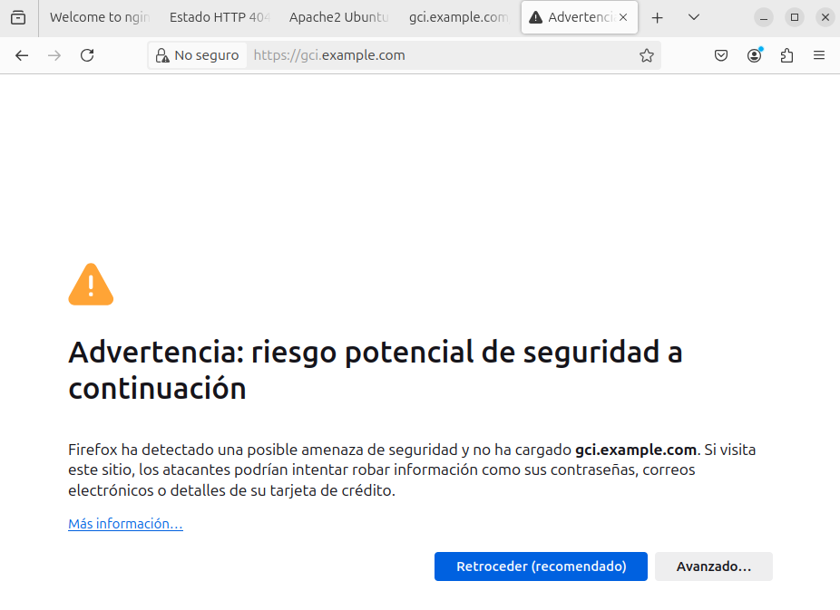

2. Pulsar **Avanzado → Aceptar el riesgo y continuar** (el texto varía según el navegador).
3. Se muestra la página personalizada servida por HTTPS.
4. Pulsar el icono junto a la dirección y consultar los detalles del certificado (Más información).

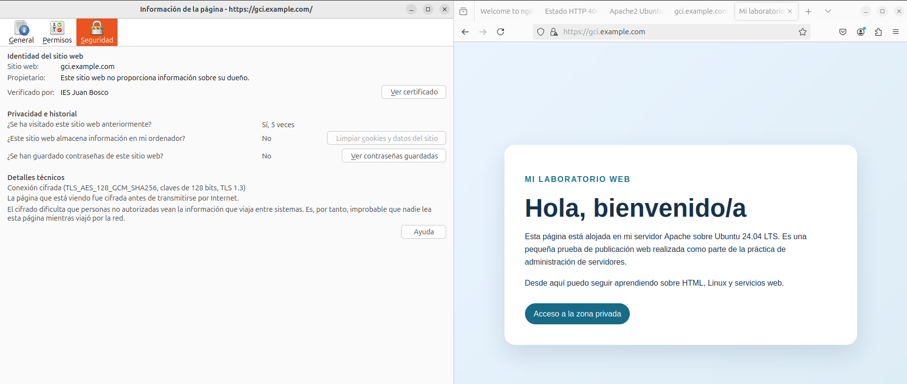

5. Escribir `http://gci.example.com` y comprobar que se redirige a `https://`.
6. Entrar en `https://gci.example.com/privado/` y comprobar que sigue pidiendo usuario y contraseña.

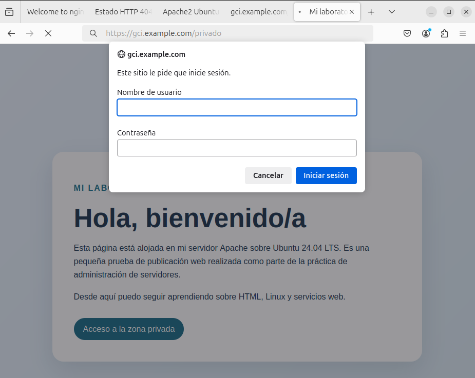

#### Con curl y openssl

```bash
# 1. HTTPS responde (-k omite la validación del certificado)
curl -kI https://gci.example.com

# 2. Sin -k, curl rechaza el certificado por no ser de confianza (error 60)
curl -I https://gci.example.com

# 3. Con el propio certificado como autoridad de confianza, la validación es correcta
curl --cacert /etc/ssl/certs/gci-selfsigned.crt -I https://gci.example.com
```

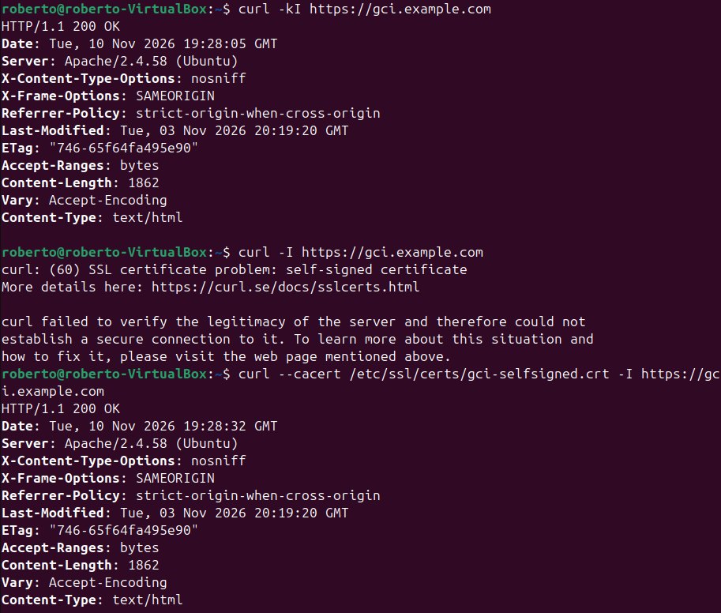

```bash
# 4. Redirección de HTTP a HTTPS
curl -I http://gci.example.com
curl -I http://gci.example.com/privado/
```

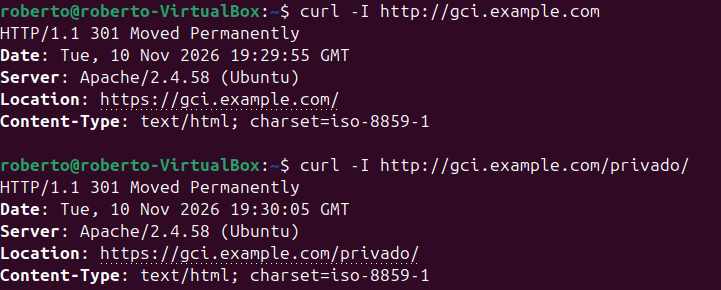

```bash
# 5. Cabeceras de seguridad
curl -kI https://gci.example.com | grep -i -E 'x-content-type|x-frame|referrer'

# 6. Versión de TLS negociada y datos del certificado
openssl s_client -connect gci.example.com:443 -servername gci.example.com </dev/null 2>/dev/null | grep -E 'Protocol|Cipher|subject|issuer|Verif'
```

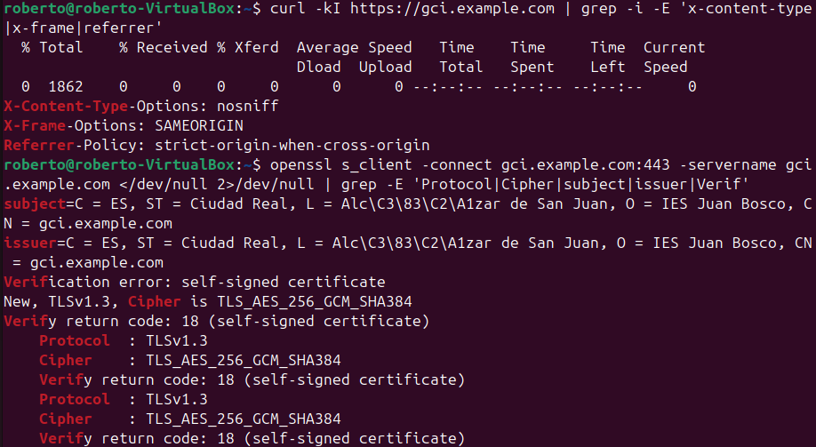

Por último, se comprueba que las peticiones HTTPS quedan registradas:

```bash
sudo tail -n 10 /var/log/apache2/gci_ssl_access.log
sudo tail -n 10 /var/log/apache2/gci_ssl_error.log
```

---

## 4. Banco de pruebas

Todas las pruebas se realizan desde la propia máquina virtual.

| Prueba y procedimiento | Resultado esperado |
|---|---|
| Módulos cargados: `apache2ctl -M \| grep -E 'ssl\|headers'` | `ssl_module` y `headers_module` |
| Sintaxis: `sudo apache2ctl configtest` | `Syntax OK` |
| Puertos: `sudo ss -tlnp \| grep -E ':(80\|443)\s'` | Apache escucha en 80 y 443 |
| Certificado: `openssl x509 -in ... -noout -subject -issuer -dates -ext subjectAltName` | CN y SAN `gci.example.com`, emisor = titular, validez de 365 días |
| Clave privada: `sudo ls -l /etc/ssl/private/gci-selfsigned.key` | Permisos `-rw-------`, propietario root |
| HTTPS responde: `curl -kI https://gci.example.com` | `HTTP/1.1 200 OK` |
| Certificado no confiable: `curl -I https://gci.example.com` | Error: certificado autofirmado (código 60) |
| Certificado válido para el nombre: `curl --cacert ... -I https://gci.example.com` | `HTTP/1.1 200 OK` |
| Redirección: `curl -I http://gci.example.com` | `301` y `Location: https://gci.example.com/` |
| Redirección con ruta: `curl -I http://gci.example.com/privado/` | `301` a `https://gci.example.com/privado/` |
| Cabeceras de seguridad en HTTPS | `X-Content-Type-Options`, `X-Frame-Options` y `Referrer-Policy` presentes |
| Versión negociada: `openssl s_client -connect ...` | `TLSv1.3` |
| TLS antiguo: `openssl s_client ... -tls1_1` | La conexión es rechazada |
| Zona privada por HTTPS sin credenciales | `401 Unauthorized` |
| Zona privada por HTTPS con credenciales (`curl -kI -u usuario1:CLAVE ...`) | `200 OK` |
| Navegador: advertencia, excepción y acceso a `https://gci.example.com` | Se muestra el sitio con `https://` |
| Registros: `gci_ssl_access.log` y `gci_ssl_error.log` | Constan las peticiones HTTPS |
| Persistencia: `sudo systemctl restart apache2` y repetir H06 | El sitio HTTPS sigue operativo |

---

## 5. Problemas y soluciones

Esta tabla recoge los problemas más habituales en esta práctica.

| Nº | Problema | Causa | Solución |
|---|---|---|---|
| 1 | El navegador muestra «Advertencia: riesgo potencial de seguridad» o `NET::ERR_CERT_AUTHORITY_INVALID`. | El certificado está autofirmado y ninguna CA de confianza lo avala. Es el comportamiento esperado. | Aceptar la excepción en el navegador, o importar el certificado como de confianza (solo en pruebas). |
| 2 | Apache no responde en el puerto 443 tras `a2enmod ssl`. | Se ha recargado en lugar de reiniciar, o el sitio `gci-ssl.conf` no está activado. | `sudo a2ensite gci-ssl.conf` y `sudo systemctl restart apache2`, comprobar con `ss -tlnp`. |
| 3 | Apache no arranca: «SSLCertificateFile: file does not exist» o error de lectura de la clave. | Ruta incorrecta en la configuración o clave no generada. | Revisar las rutas, comprobar que los ficheros existen y consultar `journalctl -xeu apache2`. |
| 4 | `NET::ERR_CERT_COMMON_NAME_INVALID` o aviso AH01909 («does NOT include an ID which matches the server name»). | El certificado no incluye el nombre en el campo SAN o el nombre no coincide con `ServerName`. | Regenerar el certificado con `-addext "subjectAltName=DNS:gci.example.com"`. |
| 5 | `ERR_TOO_MANY_REDIRECTS`. | La redirección está también en el VirtualHost 443, o hay otra regla que redirige de vuelta. | Dejar `Redirect` solo en el VirtualHost del puerto 80. |
| 6 | `/privado/` se abre por HTTPS sin pedir contraseña. | Los bloques `<Directory>` no se copiaron al VirtualHost 443. | Añadir los bloques de `privado` e `interno` a `gci-ssl.conf` y recargar. |
| 7 | Tras quitar la redirección, el navegador sigue redirigiendo a HTTPS. | El navegador guardó en caché la redirección 301. | Probar en ventana privada, borrar la caché, o usar `curl` para las comprobaciones. |

---

## 6. Resultados

Se ha habilitado HTTPS en el servidor Apache2 de la máquina virtual Ubuntu-DAW2DAW: el sitio `gci.example.com` se sirve ahora por el puerto 443 con un certificado autofirmado generado con OpenSSL, TLS 1.2 y 1.3 como únicas versiones permitidas y cabeceras de seguridad. El tráfico HTTP se redirige a HTTPS, y las zonas protegidas de la práctica anterior mantienen su control de acceso sobre la conexión cifrada.

| Objetivo | Resultado |
|---|---|
| Investigar HTTPS, tipos de certificados y módulos | Conseguido |
| Instalar y verificar Apache2 | Conseguido |
| Habilitar los módulos `ssl` y `headers` | Conseguido |
| Generar un certificado (Opción A: autofirmado) | Conseguido |
| Configurar un VirtualHost HTTPS en el puerto 443 | Conseguido |
| Redirección HTTP → HTTPS | Conseguido |
| Validación con navegador y `curl` | Conseguido |

---

## 7. Conclusión

Se han cumplido los objetivos planteados. La implementación de HTTPS en Apache se reduce a pocos pasos bien definidos: habilitar los módulos, disponer de un certificado y una clave privada, definir un VirtualHost en el puerto 443 y redirigir el puerto 80. Las partes más importantes son: comprender qué garantiza realmente cada tipo de certificado, y que la seguridad del conjunto depende de que las restricciones de acceso también se apliquen en el sitio cifrado.

---

## 8. Bibliografía

- [1] The Apache Software Foundation. (s. f.). *mod_ssl*. Apache HTTP Server Version 2.4 Documentation. <https://httpd.apache.org/docs/2.4/mod/mod_ssl.html>
- [2] The Apache Software Foundation. (s. f.). *SSL/TLS Strong Encryption: How-To*. Apache HTTP Server Version 2.4 Documentation. <https://httpd.apache.org/docs/2.4/ssl/ssl_howto.html>
- [3] The Apache Software Foundation. (s. f.). *mod_headers*. Apache HTTP Server Version 2.4 Documentation. <https://httpd.apache.org/docs/2.4/mod/mod_headers.html>
- [4] The Apache Software Foundation. (s. f.). *mod_alias*. Apache HTTP Server Version 2.4 Documentation. <https://httpd.apache.org/docs/2.4/mod/mod_alias.html>
- [5] MDN Web Docs. (s. f.). *Transport Layer Security (TLS)*. Mozilla. <https://developer.mozilla.org/en-US/docs/Web/Security/Transport_Layer_Security>
- [6] Rescorla, E. (2018). *The Transport Layer Security (TLS) Protocol Version 1.3* (RFC 8446). IETF. <https://www.rfc-editor.org/rfc/rfc8446>
- [7] Let's Encrypt. (s. f.). *How It Works*. <https://letsencrypt.org/how-it-works/>
- [8] Let's Encrypt. (s. f.). *Certificate Lifetime Rationale and Plans*. <https://letsencrypt.org/docs/cert-lifetimes/>
- [9] Electronic Frontier Foundation. (s. f.). *Certbot Instructions*. <https://certbot.eff.org/instructions>
- [10] OpenSSL Project. (s. f.). *openssl-req*. OpenSSL 3.0 Manual Pages. <https://docs.openssl.org/3.0/man1/openssl-req/>

---

## 9. Anexos

### Anexo A. Opción B: certificado de Let's Encrypt con Certbot

**Requisitos previos:**

- Un nombre de dominio público (no `example.com`) cuyo registro DNS apunte a la IP pública del servidor.
- Los puertos 80 y 443 accesibles desde Internet (el desafío HTTP-01 consiste en que Let's Encrypt descarga un fichero por HTTP desde el servidor) [7].
- Un VirtualHost de Apache con el `ServerName` correcto para ese dominio.

**Procedimiento (Certbot se instala con *snap* según las instrucciones oficiales) [9]:**

```bash
# Instalar Certbot
sudo snap install core
sudo snap refresh core
sudo apt remove certbot python3-certbot-apache   # solo si estuvieran instalados
sudo snap install --classic certbot
sudo ln -s /snap/bin/certbot /usr/bin/certbot

# Obtener e instalar el certificado en Apache
sudo certbot --apache -d midominio.ejemplo.org

# Comprobar la renovación automática
sudo certbot renew --dry-run
systemctl list-timers | grep certbot
```

Certbot valida el dominio, obtiene el certificado, crea un VirtualHost HTTPS (`*-le-ssl.conf`) y, si se le indica, configura la redirección de HTTP a HTTPS. Los certificados se guardan en `/etc/letsencrypt/live/<dominio>/` y se renuevan automáticamente mediante un temporizador del sistema.

### Anexo B. Refuerzos de seguridad no aplicados

- **HSTS** (`Strict-Transport-Security`): obliga al navegador a usar siempre HTTPS con el sitio.

  ```apache
  Header always set Strict-Transport-Security "max-age=31536000; includeSubDomains"
  ```
  Solo debe activarse con un certificado de confianza: con uno autofirmado, el navegador bloquea el acceso y no permite aceptar la excepción de seguridad.
- **Ocultar la versión de Apache:** `ServerTokens Prod` y `ServerSignature Off` en `/etc/apache2/conf-available/security.conf`.
- **Cortafuegos:** si se activase UFW, habría que permitir el tráfico web con `sudo ufw allow 'Apache Full'` (puertos 80 y 443).
- **Suites de cifrado:** restringir `SSLCipherSuite` a las recomendadas por Mozilla (generador de configuración SSL).

### Anexo C. Glosario

| Término | Definición |
|---|---|
| **TLS / SSL** | Protocolo que cifra las comunicaciones, TLS es el sucesor de SSL. |
| **HTTPS** | HTTP sobre TLS, habitualmente en el puerto 443. |
| **Certificado X.509** | Documento digital que une una clave pública con una identidad, firmado por una CA. |
| **CA (autoridad de certificación)** | Entidad de confianza que firma certificados. |
| **Autofirmado** | Certificado firmado con su propia clave, sin una CA que lo avale. |
| **SAN** | *Subject Alternative Name*: campo del certificado con los nombres para los que es válido. |
| **Handshake** | Negociación inicial en la que cliente y servidor acuerdan los parámetros de cifrado. |
| **ACME** | Protocolo que utiliza Let's Encrypt para emitir certificados de forma automática. |
| **HSTS** | Cabecera que obliga al navegador a utilizar siempre HTTPS con un sitio. |
