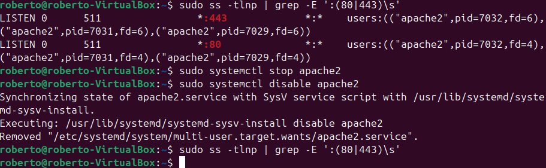
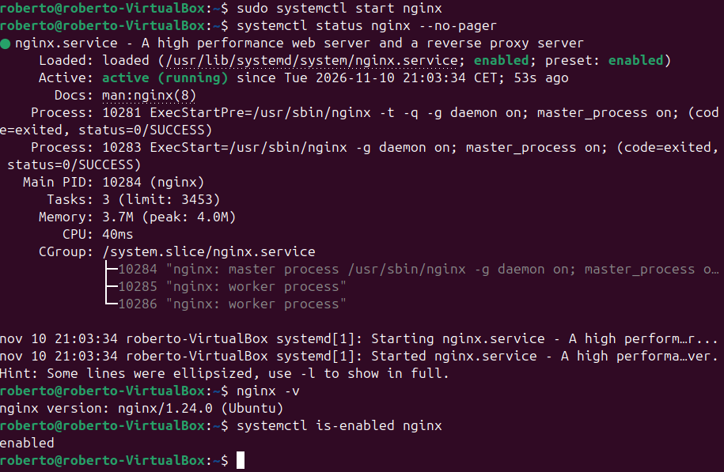
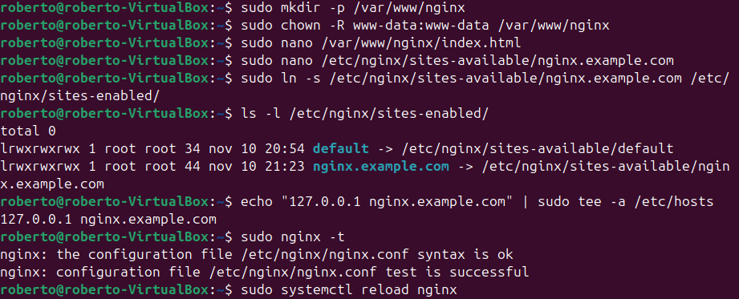
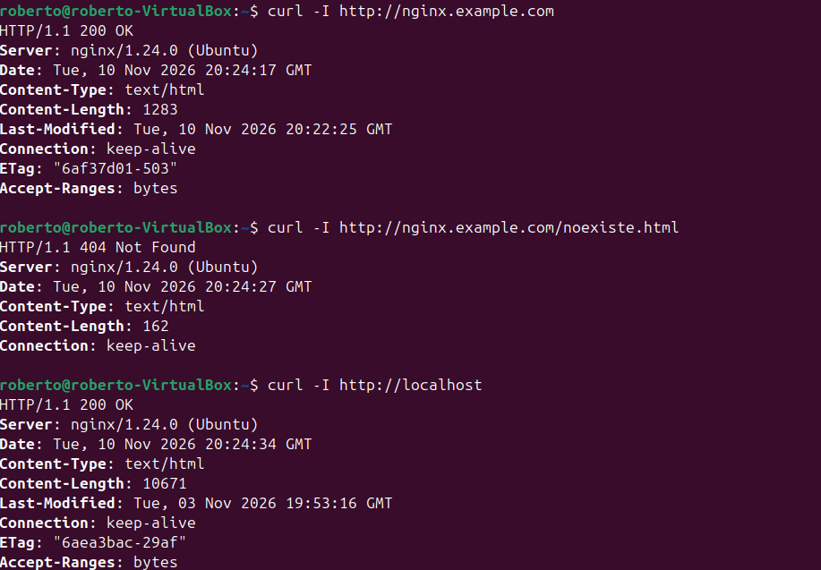
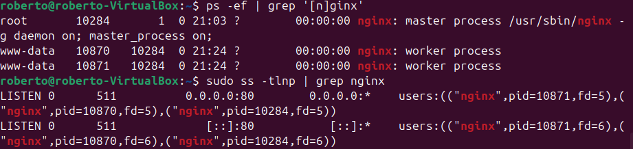

# Instalación y configuración de un servidor web Nginx sobre Ubuntu

- **Nombre:** Roberto Martín
- **Curso:** 2º DAW
- **Centro:** IES Juan Bosco

---

## Resumen

Esta memoria recoge la investigación y la instalación del servidor web Nginx sobre Ubuntu 24.04 LTS. En la parte teórica se explica qué es Nginx, en qué se diferencia de Apache y cómo se instala y se gestiona en Ubuntu. En la parte práctica se instala Nginx desde los repositorios de Ubuntu, se publica una página web personalizada mediante un bloque de servidor (equivalente al VirtualHost de Apache), se valida la configuración y se aplican los cambios sin interrumpir el servicio. El funcionamiento se comprueba con el navegador, `curl` y los registros del servidor. Como Apache ocupaba ya el puerto 80 de la máquina virtual, se documenta también cómo resolver ese conflicto.

## Palabras clave

Nginx · servidor web · server block · Ubuntu · proxy inverso · Apache · configuración · `nginx -t` · virtual host

---

## Índice

1. [Introducción](#1-introducción)
2. [Investigación teórica](#2-investigación-teórica)
3. [Implementación paso a paso](#3-implementación-paso-a-paso)
4. [Banco de pruebas](#4-banco-de-pruebas)
5. [Problemas y soluciones](#5-problemas-y-soluciones)
6. [Resultados](#6-resultados)
7. [Conclusión](#7-conclusión)
8. [Bibliografía](#8-bibliografía)
9. [Anexos](#9-anexos)

---

## 1. Introducción

### 1.1 Contexto

Esta práctica se realiza sobre la máquina virtual **Ubuntu-DAW2DAW**, la misma que se utilizó en las prácticas anteriores de virtualización y de Apache. En ella ya hay un servidor Apache configurado (con los sitios `gci.example.com`), por lo que en esta práctica se instala Nginx como segundo servidor web y se compara con el anterior.

| Elemento | Descripción |
|---|---|
| Hipervisor | Oracle VirtualBox |
| Sistema operativo | Ubuntu 24.04 LTS (Noble Numbat) |
| Servidor web instalado previamente | Apache HTTP Server 2.4.58 |
| Servidor web de esta práctica | Nginx 1.24.0 (paquete `nginx` de Ubuntu) |
| Sitio de la práctica | `nginx.example.com` (`root /var/www/nginx`) |
| Resolución de nombres | Entrada en `/etc/hosts` (`127.0.0.1 nginx.example.com`) |

### 1.2 Objetivos

- Investigar qué es Nginx y en qué se diferencia de Apache.
- Investigar cómo se instala y se ejecuta Nginx en Ubuntu.
- Instalar Nginx y comprobar su funcionamiento.
- Configurar un bloque de servidor (equivalente al VirtualHost de Apache) para publicar una página web.
- Validar la configuración y aplicar los cambios.

---

## 2. Investigación teórica

### 2.1 ¿Qué es Nginx?

**Nginx** (se pronuncia «engine x») es un servidor web de código abierto que también se utiliza como **proxy inverso**, **balanceador de carga**, **caché HTTP** y proxy de correo [1][6]. Fue creado por el programador ruso Igor Sysoev, que publicó su primera versión pública en 2004 para resolver el llamado problema C10k: atender decenas de miles de conexiones simultáneas con pocos recursos. En 2011 se fundó la empresa Nginx, Inc., adquirida en 2019 por F5 [6]. El software se distribuye con una licencia de tipo BSD de dos cláusulas.

**Funcionamiento.** Nginx utiliza una arquitectura **asíncrona y orientada a eventos** [2]:

- Un proceso **maestro** (*master*) lee la configuración y gestiona los procesos de trabajo.
- Varios procesos **trabajadores** (*worker*) atienden las conexiones. Cada uno puede gestionar miles de conexiones a la vez sin crear un hilo o un proceso por cliente, por lo que el consumo de memoria es bajo y estable.

**Usos habituales:**

- Servir **contenido estático** (HTML, CSS, JavaScript, imágenes) con mucha rapidez.
- Actuar como **proxy inverso** delante de servidores de aplicaciones (Node.js, Tomcat, PHP-FPM, Gunicorn…).
- **Balancear la carga** entre varios servidores.
- Terminar las conexiones **HTTPS** (TLS) y cachear respuestas.

**Configuración.** Se escribe en ficheros de texto con una sintaxis declarativa basada en **bloques** (contextos) anidados, y cada directiva termina en punto y coma [1]:

```
http {                              # contexto general de HTTP
    server {                        # un sitio (equivalente a un VirtualHost)
        listen 80;
        server_name ejemplo.org;

        location / {                # reglas para una ruta
            root /var/www/ejemplo;
        }
    }
}
```

### 2.2 Diferencias principales entre Nginx y Apache

| Aspecto | Apache HTTP Server | Nginx |
|---|---|---|
| **Origen** | 1995 (Apache Software Foundation). | 2004 (Igor Sysoev). |
| **Arquitectura** | Módulos de multiprocesamiento (MPM): `prefork` (un proceso por conexión), `worker` (hilos) y `event`. | Siempre asíncrona y orientada a eventos, con un maestro y varios *workers*. |
| **Consumo con mucha concurrencia** | Mayor, sobre todo con `prefork`. | Menor y más estable. |
| **Contenido estático** | Bueno. | Muy eficiente. |
| **Contenido dinámico** | Puede ejecutarlo dentro del propio servidor (por ejemplo, `mod_php`). | Lo delega siempre en procesos externos (PHP-FPM, FastCGI, `proxy_pass`). |
| **Configuración por directorio** | Admite ficheros `.htaccess` que se leen en cada petición [7]. | No existe `.htaccess`: toda la configuración está centralizada y requiere recargar. |
| **Módulos** | Se activan y desactivan en caliente (`a2enmod`). | Tradicionalmente se compilan con el programa; desde la versión 1.9.11 existen módulos dinámicos (`load_module`). |
| **Proxy inverso y balanceo** | Disponible mediante `mod_proxy`. | Es uno de sus puntos fuertes y su uso más extendido. |
| **Sintaxis** | Etiquetas XML (`<VirtualHost>`, `<Directory>`). | Bloques con llaves (`server {}`, `location {}`) y punto y coma. |
| **Licencia** | Apache License 2.0. | BSD de dos cláusulas. |
| **Plataformas** | Multiplataforma, incluido Windows. | Pensado para Unix/Linux; soporte limitado en Windows. |
| **Uso típico** | Alojamiento compartido, aplicaciones que usan `.htaccess`, muchos módulos. | Alta concurrencia, contenido estático, proxy inverso y balanceo. |

No son excluyentes: es habitual colocar Nginx como proxy inverso delante de Apache, de forma que Nginx atienda los ficheros estáticos y Apache la parte dinámica.

**Equivalencias entre las configuraciones de ambos servidores**:

| Apache | Nginx |
|---|---|
| `<VirtualHost *:80>` | `server { listen 80; }` |
| `ServerName` | `server_name` |
| `DocumentRoot` | `root` |
| `DirectoryIndex` | `index` |
| `ErrorLog` / `CustomLog` | `error_log` / `access_log` |
| `<Directory>` / `<Location>` | `location` |
| `Redirect permanent / https://...` | `return 301 https://...;` |
| `a2ensite` (activar un sitio) | Enlace simbólico en `sites-enabled` (`ln -s`) |
| `apache2ctl configtest` | `nginx -t` |
| `systemctl reload apache2` | `systemctl reload nginx` |

### 2.3 Instalación y ejecución de Nginx en Ubuntu

**Formas de instalarlo:**

1. **Repositorios de Ubuntu** (`apt install nginx`): es la opción más sencilla y la que se utiliza en esta práctica. Ubuntu 24.04 incluye la versión **1.24.0**, que recibe las actualizaciones de seguridad de la distribución [8].
2. **Repositorio oficial de nginx.org**: permite instalar las ramas *stable* o *mainline*, más recientes que la de Ubuntu [5] (véase el Anexo A).
3. **Compilación del código fuente**: máxima flexibilidad, pero con más trabajo de mantenimiento.

**Gestión del servicio.** Nginx funciona como un servicio de `systemd`:

| Comando | Función |
|---|---|
| `sudo systemctl start nginx` | Inicia el servicio. |
| `sudo systemctl stop nginx` | Lo detiene. |
| `sudo systemctl restart nginx` | Lo detiene y lo vuelve a iniciar (corta las conexiones). |
| `sudo systemctl reload nginx` | Recarga la configuración sin cortar las conexiones. |
| `sudo systemctl enable nginx` / `disable` | Activa o desactiva el arranque automático. |
| `systemctl status nginx` | Muestra el estado. |
| `sudo nginx -t` | Comprueba la sintaxis de la configuración. |
| `nginx -v` | Muestra la versión. |

**Estructura de ficheros en Ubuntu:**

| Ruta | Contenido |
|---|---|
| `/etc/nginx/nginx.conf` | Configuración principal. |
| `/etc/nginx/sites-available/` | Configuración de los sitios disponibles. |
| `/etc/nginx/sites-enabled/` | Enlaces simbólicos a los sitios activados. |
| `/etc/nginx/conf.d/` | Ficheros de configuración adicionales (`*.conf`). |
| `/var/www/html/` | Directorio del sitio por defecto. |
| `/var/log/nginx/` | Registros `access.log` y `error.log`. |

El proceso se ejecuta con el usuario `www-data`, y el servicio escucha por defecto en el puerto **80**.

---

## 3. Implementación paso a paso

### 3.1 Preparación: liberar el puerto 80

Apache sigue instalado y activo en la máquina virtual, y ocupa los puertos 80 y 443. Dos servidores no pueden escuchar en el mismo puerto, por lo que antes de instalar Nginx se comprueba qué proceso usa el puerto 80 y se detiene Apache:

```bash
sudo ss -tlnp | grep -E ':(80|443)\s'
sudo systemctl stop apache2
sudo systemctl disable apache2
sudo ss -tlnp | grep -E ':(80|443)\s'
```

- `stop` detiene Apache en ese momento, y `disable` evita que arranque de nuevo al reiniciar la máquina (lo que volvería a ocupar el puerto 80).
- La configuración de Apache no se toca: puede reactivarse al terminar la práctica (Anexo B).
- La segunda comprobación no debe mostrar ningún resultado.



### 3.2 Instalación de Nginx

```bash
sudo apt update
sudo apt install nginx
```

Tras la instalación, el servicio se inicia y se habilita para el arranque de forma automática. Se comprueba su estado y su versión:

```bash
sudo systemctl start nginx
systemctl status nginx --no-pager
nginx -v
systemctl is-enabled nginx
```



### 3.3 Creación del contenido del sitio

Se crea el directorio del sitio y se asigna al usuario con el que se ejecuta Nginx:

```bash
sudo mkdir -p /var/www/nginx
sudo chown -R www-data:www-data /var/www/nginx
sudo nano /var/www/nginx/index.html
```

Dentro de `index.html` se escribe una página sencilla (en verde, para distinguirla de la de Apache):

```html
<!doctype html>
<html lang="es">
<head>
  <meta charset="utf-8">
  <meta name="viewport" content="width=device-width, initial-scale=1">
  <title>Mi laboratorio web con Nginx</title>
  <style>
    * {
      box-sizing: border-box;
    }
    body {
      margin: 0;
      min-height: 100vh;
      display: grid;
      place-items: center;
      padding: 24px;
      font-family: Arial, sans-serif;
      color: #1b3a2a;
      background: linear-gradient(135deg, #e8f8ee, #d3efdf);
    }
    main {
      width: min(720px, 100%);
      padding: 42px;
      border-radius: 22px;
      background: white;
      box-shadow: 0 18px 45px #1b3a2a22;
    }
    .tag {
      color: #1a7f4b;
      font-weight: bold;
      letter-spacing: .12em;
    }
    h1 {
      margin: 12px 0;
      font-size: clamp(2rem, 6vw, 3.2rem);
    }
    p {
      line-height: 1.65;
    }
  </style>
</head>
<body>
  <main>
    <p class="tag">MI LABORATORIO WEB</p>
    <h1>Hola desde Nginx</h1>
    <p>Esta página está alojada en un servidor Nginx sobre Ubuntu 24.04
    LTS. Es la misma máquina virtual en la que antes se publicaba con
    Apache.</p>
    <p>Lo que cambia es el servidor: aquí los sitios se definen con
    bloques <code>server</code> en lugar de VirtualHost.</p>
  </main>
</body>
</html>
```

La etiqueta `<meta charset="utf-8">` es importante para que las tildes y la «ñ» se muestren correctamente en el navegador.

### 3.4 Configuración del servidor (bloque de servidor)

En Nginx, el equivalente al VirtualHost de Apache es el **bloque `server`**. Se crea un fichero para el sitio en `sites-available`:

```bash
sudo nano /etc/nginx/sites-available/nginx.example.com
```

```nginx
server {
    listen 80;
    listen [::]:80;

    server_name nginx.example.com;

    root /var/www/nginx;
    index index.html;

    access_log /var/log/nginx/nginx.example.com.access.log;
    error_log  /var/log/nginx/nginx.example.com.error.log;

    location / {
        try_files $uri $uri/ =404;
    }
}
```

| Directiva | Función | Valor |
|---|---|---|
| `listen` | Puerto (y dirección) en el que escucha el servidor; la segunda línea es para IPv6. | `80` |
| `server_name` | Nombre con el que se accede al sitio; Nginx lo usa para elegir el bloque `server` [4]. | `nginx.example.com` |
| `root` | Directorio del que se toman los ficheros del sitio. | `/var/www/nginx` |
| `index` | Fichero que se muestra al pedir un directorio. | `index.html` |
| `access_log` / `error_log` | Ficheros de registro propios del sitio. | `/var/log/nginx/...` |
| `location /` | Reglas para las peticiones que empiezan por `/`. | — |
| `try_files $uri $uri/ =404` | Busca el fichero, luego el directorio y, si no existe ninguno, responde 404. | — |

Se activa el sitio creando un enlace simbólico en `sites-enabled` (el equivalente a `a2ensite`) y se añade el nombre al fichero `/etc/hosts`, ya que `example.com` es un dominio reservado que no se resuelve en ningún DNS:

```bash
sudo ln -s /etc/nginx/sites-available/nginx.example.com /etc/nginx/sites-enabled/
ls -l /etc/nginx/sites-enabled/
echo "127.0.0.1 nginx.example.com" | sudo tee -a /etc/hosts
```

El sitio `default` sigue activado y atiende todas las peticiones que no coinciden con ningún `server_name`, como `http://localhost`.

### 3.5 Validación y aplicación de los cambios

Antes de aplicar la configuración se valida su sintaxis; después se recarga el servicio:

```bash
sudo nginx -t
sudo systemctl reload nginx
```

- `nginx -t` debe mostrar `syntax is ok` y `test is successful`. Si hay un error, indica el fichero y la línea.
- `reload` hace que el proceso maestro lea la nueva configuración, arranque nuevos *workers* y cierre los antiguos cuando terminen sus conexiones, por lo que **no se interrumpe el servicio**. Nginx no detecta por sí solo los cambios en los ficheros: siempre hay que recargarlo.



### 3.6 Verificación del acceso mediante Nginx

**Con `curl`:** la cabecera `Server` confirma qué servidor responde.

```bash
curl -I http://nginx.example.com
curl -I http://nginx.example.com/noexiste.html
curl -I http://localhost
```

La primera petición debe devolver `200 OK` con `Server: nginx/1.24.0 (Ubuntu)`; la segunda, `404 Not Found`; y la tercera, `200 OK` desde el sitio por defecto.



**Procesos y puertos:** se comprueba la arquitectura de un proceso maestro y varios *workers*, y los puertos en escucha:

```bash
ps -ef | grep '[n]ginx'
sudo ss -tlnp | grep nginx
```



**Registros:**

```bash
sudo tail -n 10 /var/log/nginx/nginx.example.com.access.log
sudo tail -n 10 /var/log/nginx/nginx.example.com.error.log
```

---

## 4. Banco de pruebas

Todas las pruebas se realizan desde la propia máquina virtual.

| Prueba y procedimiento | Resultado esperado |
|---|---|
| Puerto 80 libre antes de instalar: `sudo ss -tlnp \| grep -E ':(80\|443)\s'` | Sin resultados tras detener Apache |
| Versión: `nginx -v` | `nginx version: nginx/1.24.0 (Ubuntu)` |
| Servicio activo: `systemctl status nginx` | `active (running)` |
| Arranque automático: `systemctl is-enabled nginx` | `enabled` |
| Puerto: `sudo ss -tlnp \| grep nginx` | Nginx escucha en el puerto 80 (IPv4 e IPv6) |
| Procesos: `ps -ef \| grep '[n]ginx'` | Un proceso `master` (root) y varios `worker` (www-data) |
| Sintaxis: `sudo nginx -t` | `syntax is ok` y `test is successful` |
| Sitio por defecto: `curl -I http://localhost` | `HTTP/1.1 200 OK` y `Server: nginx` |
| Sitio personalizado: abrir `http://nginx.example.com` en el navegador | Se muestra la página personalizada |
| Cabeceras: `curl -I http://nginx.example.com` | `HTTP/1.1 200 OK` y `Server: nginx/1.24.0 (Ubuntu)` |
| Recurso inexistente: `curl -I http://nginx.example.com/noexiste.html` | `404 Not Found` |
| Registros: `sudo tail` de `access.log` y `error.log` del sitio | Las peticiones constan en el registro de acceso |
| Recarga sin corte: `sudo systemctl reload nginx` y repetir la prueba del sitio | Sin errores y el sitio sigue operativo |
| Persistencia: `sudo systemctl restart nginx` y repetir la prueba del sitio | El sitio sigue operativo |

---

## 5. Problemas y soluciones

Esta tabla recoge los problemas más habituales en esta práctica.

| Nº | Problema | Causa | Solución |
|---|---|---|---|
| 1 | Nginx no arranca tras instalarlo: `bind() to 0.0.0.0:80 failed (98: Address already in use)`. | Apache (u otro servicio) ya está escuchando en el puerto 80. | `sudo systemctl stop apache2` y `sudo systemctl disable apache2`; después `sudo systemctl start nginx`. Comprobar con `ss -tlnp`. |
| 2 | `nginx -t` falla con `directive is not terminated by ";"` o `unexpected end of file`. | Falta un punto y coma o una llave en el fichero de configuración. | Revisar la línea que indica el mensaje. Cada directiva termina en `;` y cada bloque se cierra con `}`. |
| 3 | El sitio responde `403 Forbidden`. | Falta el fichero `index.html`, o `www-data` no puede leer el directorio. | Comprobar que existe `/var/www/nginx/index.html` y repetir `sudo chown -R www-data:www-data /var/www/nginx`. |
| 4 | El navegador no encuentra `nginx.example.com`. | El dominio no existe en ningún DNS y falta la entrada en `/etc/hosts`. | Añadir `127.0.0.1 nginx.example.com` a `/etc/hosts`. |
| 5 | En `nginx.example.com` se sigue viendo «Welcome to nginx!». | El sitio no está activado (falta el enlace en `sites-enabled`), no se ha recargado Nginx, o hay una errata en `server_name`. | Revisar `ls -l /etc/nginx/sites-enabled/`, ejecutar `sudo nginx -t` y `sudo systemctl reload nginx`, y probar en una ventana privada. |
| 6 | Los cambios en la configuración no se aprecian. | Nginx no lee los ficheros de configuración automáticamente. | Ejecutar `sudo systemctl reload nginx` después de cada cambio. |

---

## 6. Resultados

Se ha instalado Nginx 1.24.0 en la máquina virtual Ubuntu-DAW2DAW y se ha publicado una página web personalizada mediante un bloque `server` propio, accesible por el nombre `nginx.example.com`. La configuración se ha validado con `nginx -t` y se ha aplicado con una recarga, sin interrumpir el servicio. El funcionamiento se ha comprobado con el navegador, con `curl` y con los registros del servidor.

| Objetivo | Resultado |
|---|---|
| Investigar qué es Nginx y sus diferencias con Apache | Conseguido |
| Investigar la instalación y ejecución en Ubuntu | Conseguido |
| Instalar Nginx y verificar su funcionamiento | Conseguido |
| Configurar un bloque de servidor y publicar una página | Conseguido |
| Validar y aplicar los cambios | Conseguido |

---

## 7. Conclusión

Se han cumplido los objetivos planteados. Instalar Nginx en Ubuntu es inmediato con `apt`, y publicar un sitio requiere solo un directorio con contenido y un bloque `server` activado con un enlace simbólico. El flujo de trabajo es muy parecido al de Apache (crear la configuración, activarla, validarla y recargar), y los conceptos se corresponden uno a uno: `server` con `VirtualHost`, `server_name` con `ServerName` y `root` con `DocumentRoot`.

Las diferencias principales aparecen en el diseño. Nginx utiliza un modelo asíncrono con pocos procesos, centraliza toda la configuración (sin `.htaccess`) y delega el contenido dinámico en procesos externos, lo que lo hace especialmente adecuado para contenido estático, alta concurrencia y funciones de proxy inverso. Apache ofrece más flexibilidad por directorio y un ecosistema de módulos muy amplio.

La dificultad principal del proceso es práctica: Apache ya ocupaba el puerto 80 de la máquina virtual, por lo que hubo que detenerlo antes de instalar Nginx. También hay que recordar que Nginx no aplica los cambios por sí solo.

---

## 8. Bibliografía

- [1] nginx.org. (s. f.). *nginx documentation*. <https://nginx.org/en/docs/>
- [2] nginx.org. (s. f.). *Beginner's Guide*. <https://nginx.org/en/docs/beginners_guide.html>
- [3] nginx.org. (s. f.). *How nginx processes a request*. <https://nginx.org/en/docs/http/request_processing.html>
- [4] nginx.org. (s. f.). *Server names*. <https://nginx.org/en/docs/http/server_names.html>
- [5] nginx.org. (s. f.). *Linux packages*. <https://nginx.org/en/linux_packages.html>
- [6] Wikipedia. (s. f.). *Nginx*. <https://en.wikipedia.org/wiki/Nginx>
- [7] The Apache Software Foundation. (s. f.). *Apache HTTP Server Tutorial: .htaccess files*. Apache HTTP Server Version 2.4 Documentation. <https://httpd.apache.org/docs/2.4/howto/htaccess.html>
- [8] Canonical Ltd. (s. f.). *Package: nginx (noble)*. Ubuntu Packages. <https://packages.ubuntu.com/noble/web/nginx>

---

## 9. Anexos

### Anexo A. Instalación desde el repositorio oficial de nginx.org

Alternativa a la versión de los repositorios de Ubuntu, para disponer de una versión más reciente (rama *stable*) [5]. No se ha ejecutado en esta práctica:

```bash
sudo apt install curl gnupg2 ca-certificates lsb-release ubuntu-keyring
curl https://nginx.org/keys/nginx_signing.key | gpg --dearmor | sudo tee /usr/share/keyrings/nginx-archive-keyring.gpg >/dev/null
echo "deb [signed-by=/usr/share/keyrings/nginx-archive-keyring.gpg] http://nginx.org/packages/ubuntu `lsb_release -cs` nginx" | sudo tee /etc/apt/sources.list.d/nginx.list
sudo apt update
sudo apt install nginx
```

Con esta instalación, la estructura de configuración cambia: no existe `sites-available/sites-enabled`, y los sitios se definen en ficheros `.conf` dentro de `/etc/nginx/conf.d/`.

### Anexo B. Coexistencia con Apache

**Volver a usar Apache** al terminar la práctica:

```bash
sudo systemctl stop nginx
sudo systemctl disable nginx
sudo systemctl enable --now apache2
```

**Ejecutar ambos servidores a la vez:** basta con que Nginx escuche en un puerto distinto, por ejemplo cambiando `listen 80;` por `listen 8080;` en el bloque `server` (y en el sitio `default`, o eliminando el enlace de `sites-enabled/default`). El sitio se abriría entonces en `http://nginx.example.com:8080`.

### Anexo C. Comandos de administración

| Comando | Función |
|---|---|
| `sudo nginx -t` | Comprueba la sintaxis de la configuración. |
| `sudo nginx -T` | Comprueba y muestra la configuración completa cargada. |
| `nginx -V` | Muestra la versión y las opciones con las que se compiló. |
| `sudo systemctl start \| stop \| restart \| reload \| status nginx` | Gestión del servicio. |
| `sudo systemctl enable \| disable nginx` | Activa o desactiva el arranque automático. |
| `sudo ln -s /etc/nginx/sites-available/<sitio> /etc/nginx/sites-enabled/` | Activa un sitio. |
| `sudo rm /etc/nginx/sites-enabled/<sitio>` | Desactiva un sitio (solo elimina el enlace). |
| `sudo ufw allow 'Nginx HTTP'` | Permite el puerto 80 si UFW está activo. |

### Anexo D. Glosario

| Término | Definición |
|---|---|
| **Nginx** | Servidor web, proxy inverso y balanceador de carga de código abierto. |
| **Server block** | Bloque `server { }` de Nginx que define un sitio; equivale al VirtualHost de Apache. |
| **Location** | Bloque que define las reglas para una ruta o patrón de URL. |
| **Proxy inverso** | Servidor que recibe las peticiones de los clientes y las reenvía a otro servidor. |
| **Balanceador de carga** | Reparte las peticiones entre varios servidores. |
| **Master / worker** | Proceso maestro que gestiona la configuración y procesos de trabajo que atienden las conexiones. |
| **Asíncrono / orientado a eventos** | Modelo en el que un mismo proceso atiende muchas conexiones sin bloquearse en cada una. |
| **C10k** | Problema de atender diez mil conexiones simultáneas con un solo servidor. |
| **`.htaccess`** | Fichero de configuración por directorio de Apache; Nginx no lo admite. |
