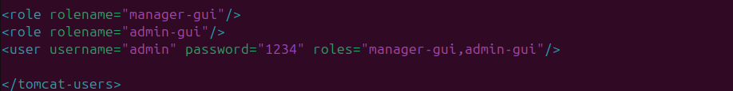
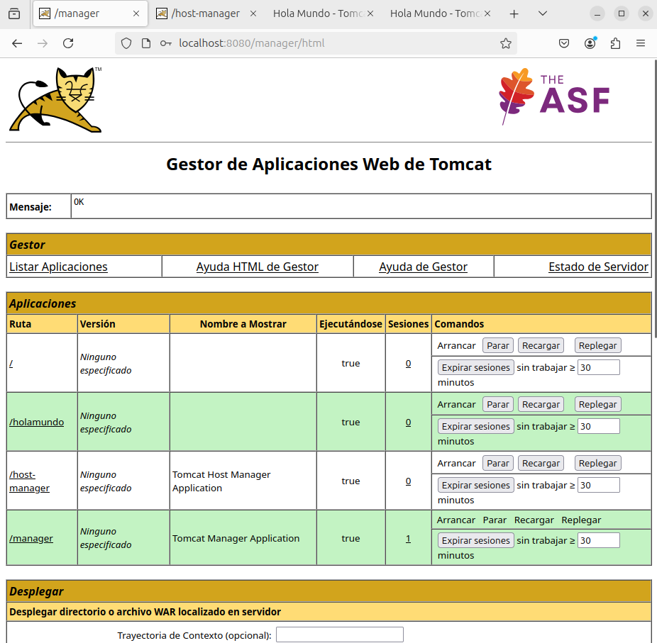
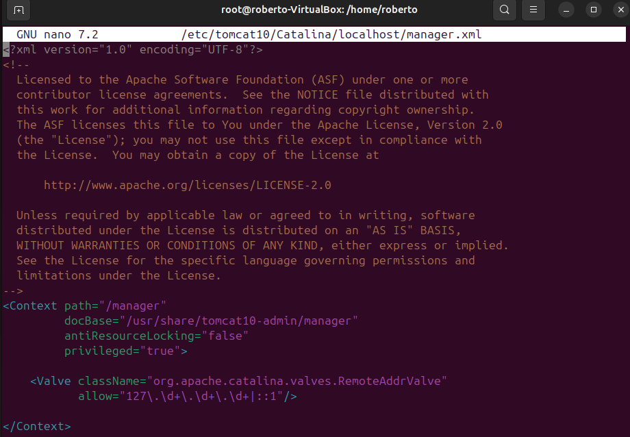
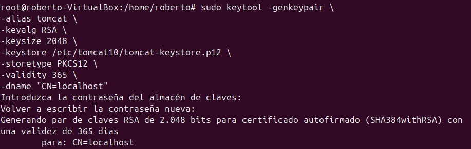
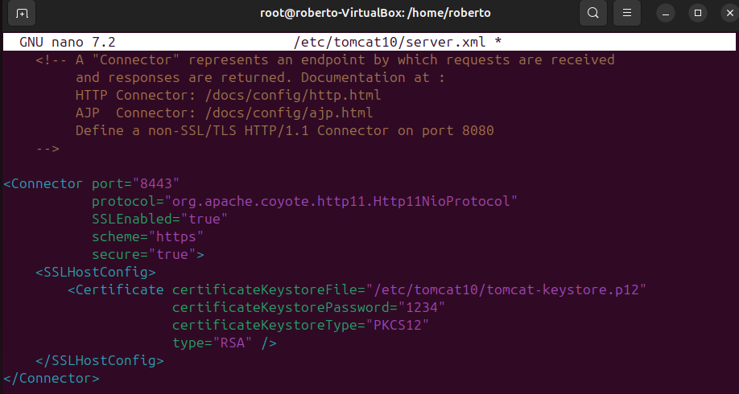
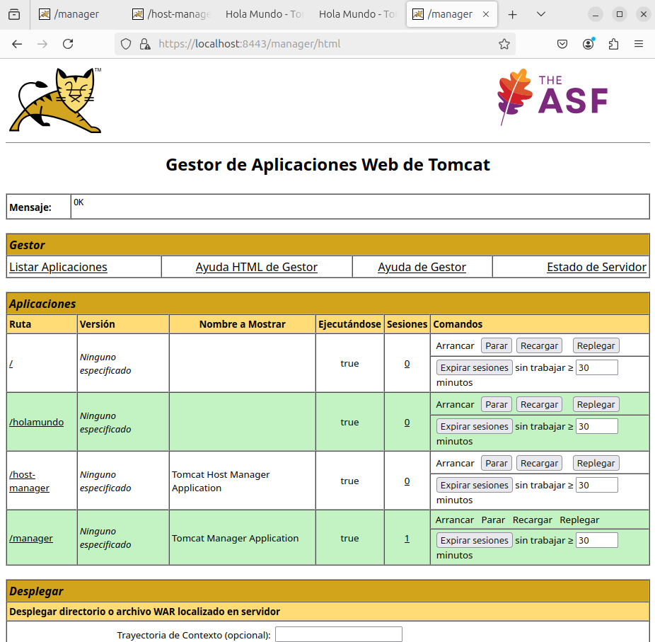

# Tomcat: Configuración de seguridad en Tomcat

## 1. Configurar usuarios y roles

Se ha editado el archivo `tomcat-users.xml` para definir el rol `manager-gui` y crear un usuario llamado `admin` con permisos para acceder al panel de administración de Tomcat.

## 2. Comprobar el acceso autenticado

Se ha accedido a `http://localhost:8080/manager/html`. Tomcat ha solicitado un usuario y una contraseña. Después de introducir las credenciales configuradas, se ha conseguido acceder correctamente al panel Manager.

## 3. Restringir el acceso al Manager

Se ha modificado el archivo `manager.xml` para añadir una restricción mediante `RemoteAddrValve`. De esta forma, se permite el acceso desde la propia máquina y se bloquean las conexiones desde otras direcciones IP.

## 4. Crear el keystore y configurar HTTPS

Se ha generado un almacén de claves (*keystore*) en formato PKCS12 para Tomcat. 

Después, se ha configurado un conector SSL en el archivo `server.xml`, utilizando el puerto 8443 para permitir conexiones HTTPS directamente a Tomcat.

## 5. Comprobar el acceso mediante HTTPS

Se ha accedido a `https://localhost:8443/manager/html`. Tomcat ha establecido una conexión HTTPS y ha solicitado las credenciales de acceso. Tras introducirlas, se ha comprobado que el panel Manager funciona correctamente mediante una conexión segura.

