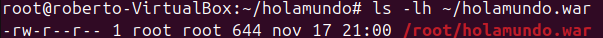
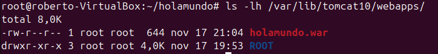
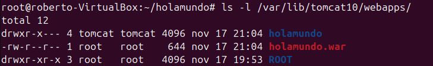
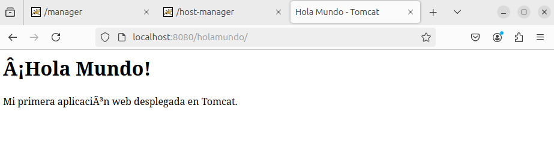

# Tomcat: Despliegue simple de una aplicación web

## 1. Crear una aplicación web y generar el archivo WAR

Se ha creado una aplicación JSP sencilla llamada `holamundo`, que muestra un mensaje de bienvenida. Después, se ha generado el archivo `holamundo.war`.

## 2. Desplegar el WAR en la carpeta webapps

Se ha copiado el archivo `holamundo.war` en la carpeta `webapps` de Tomcat para que pueda desplegarse.

## 3. Observar el despliegue automático de Tomcat

Tomcat detecta el archivo WAR, lo descomprime en una carpeta con el mismo nombre, crea el contexto de la aplicación y la prepara para recibir peticiones.

## 4. Acceder a la aplicación web

Se ha accedido a `http://localhost:8080/holamundo` desde el navegador y se ha comprobado que la aplicación muestra correctamente el mensaje «¡Hola Mundo!».

