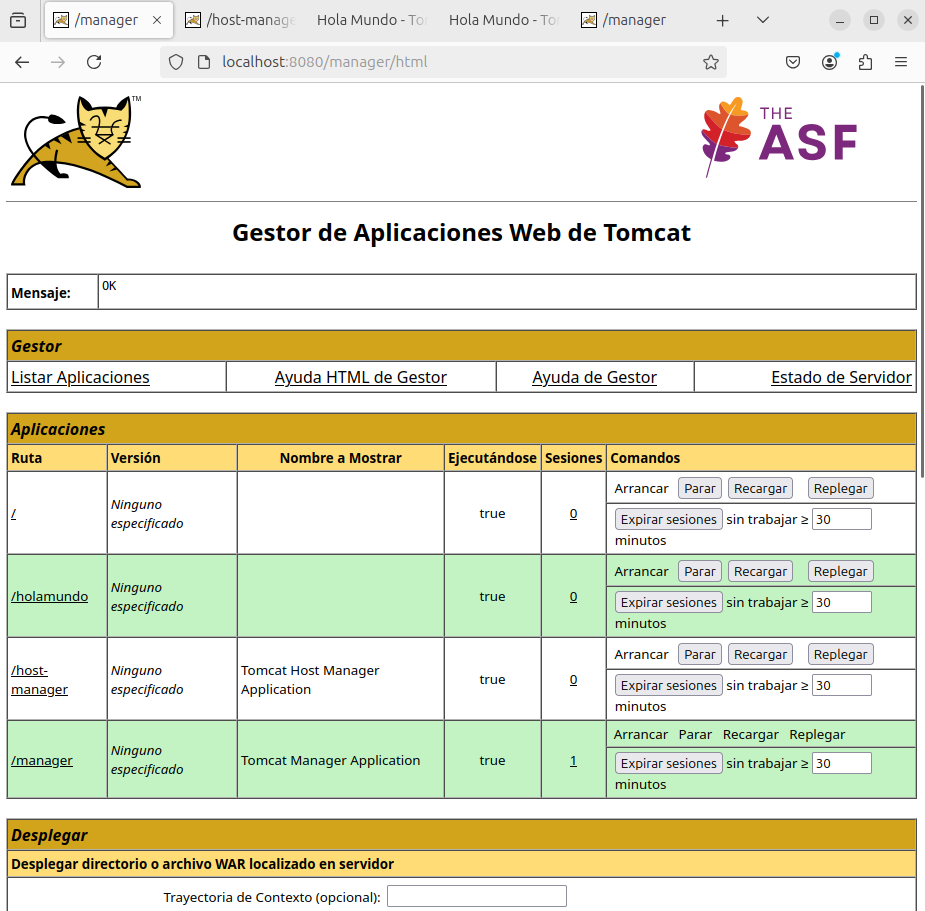
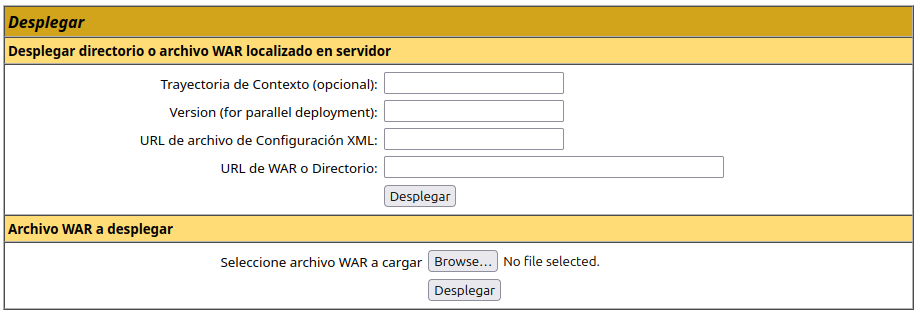
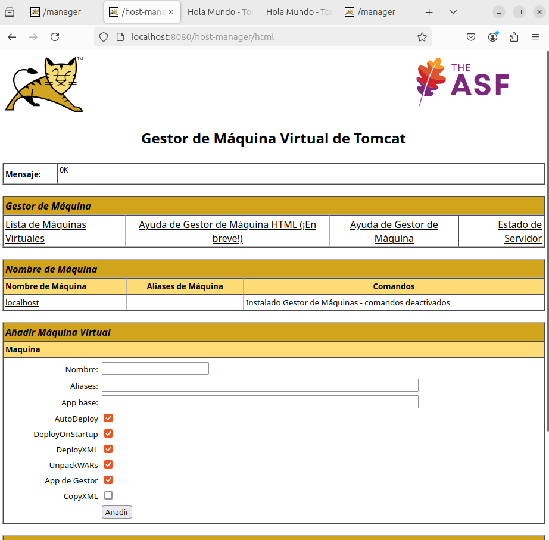
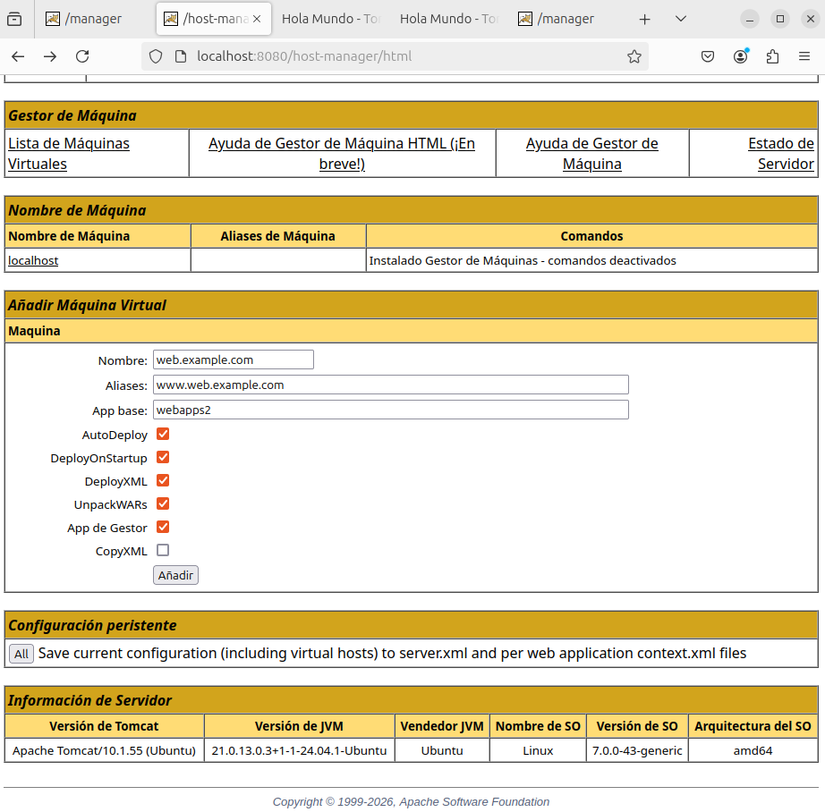

# Tomcat: Herramientas de administración — Manager y Host Manager

## 1. Configurar los permisos de administración

Para acceder a las interfaces Manager y Host Manager es necesario disponer de los roles `manager-gui` y `admin-gui`.

Se ha modificado el archivo `/etc/tomcat10/tomcat-users.xml` para asignar ambos roles al usuario `admin`.

```bash
sudo nano /etc/tomcat10/tomcat-users.xml
```

Se añaden las siguientes líneas dentro del elemento `<tomcat-users>`:

```xml
<role rolename="manager-gui"/>
<role rolename="admin-gui"/>

<user username="admin"
      password="contraseña"
      roles="manager-gui,admin-gui"/>
```

Después, se reinicia Tomcat para aplicar los cambios:

```bash
sudo systemctl restart tomcat10
```

---

## 2. Acceder a Tomcat Manager

Se accede a la interfaz Manager desde el navegador mediante la siguiente dirección:

`http://localhost:8080/manager/html`

Se introducen las credenciales del usuario `admin`. La interfaz muestra las aplicaciones desplegadas y permite administrarlas.



### Funciones principales

Manager permite realizar las siguientes operaciones:

- **Desplegar:** desplegar aplicaciones web mediante archivos WAR.
- **Recargar:** recargar una aplicación para volver a inicializarla.
- **Parar:** detener una aplicación sin eliminarla.
- **Arrancar:** iniciar una aplicación detenida.
- **Replegar:** eliminar una aplicación del servidor.

Para comprobar el despliegue, se utiliza el archivo WAR de la aplicación `holamundo`, creado en una práctica anterior.

Desde el apartado **Archivo WAR a desplegar** se selecciona el archivo y se pulsa **Desplegar**.

También se puede comprobar el funcionamiento de las opciones Recargar, Parar y Arrancar sobre la aplicación desplegada.



---

## 3. Acceder a Tomcat Host Manager

Se accede a Host Manager desde el navegador mediante la dirección:

`http://localhost:8080/host-manager/html`

Se introducen las credenciales del usuario `admin`. La interfaz permite consultar y administrar los hosts virtuales de Tomcat.



### Funciones principales

Host Manager permite:

- **Crear:** añadir nuevos hosts virtuales.
- **Consultar:** visualizar los hosts configurados.
- **Iniciar:** iniciar un host virtual.
- **Detener:** detener un host virtual.
- **Eliminar:** eliminar un host virtual.

---

## 4. Crear un host virtual

Desde Host Manager, en el apartado **Añadir Máquina Virtual**, se puede crear un nuevo host virtual indicando sus parámetros.

Para realizar una prueba se utilizan los siguientes valores:

| Parámetro | Valor |
|---|---|
| Name | `web.example.com` |
| Aliases | `www.web.example.com` |
| App Base | `webapps2` |
| Auto Deploy | `true` |
| Deploy on Startup | `true` |
| Unpack WARs | `true` |

Se pulsa **Añadir** para crear el nuevo host.



Una vez creado, el nuevo host aparece en el listado de Host Manager, desde donde se puede iniciar, detener o eliminar.

---

## 5. Conclusión

Tomcat dispone de dos herramientas web para facilitar su administración:

- **Manager:** permite desplegar, recargar, iniciar, detener y eliminar aplicaciones web.
- **Host Manager:** permite crear y administrar los hosts virtuales del servidor.

Ambas herramientas permiten gestionar Tomcat desde el navegador y utilizan roles específicos para controlar el acceso a sus funciones.