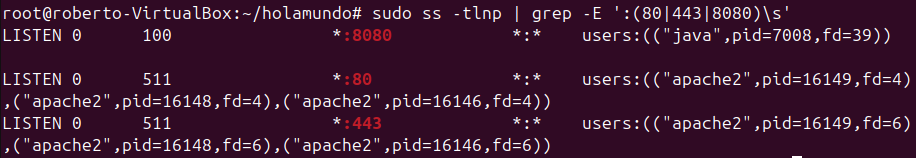
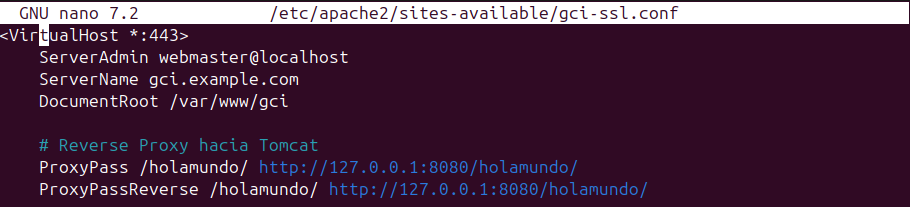
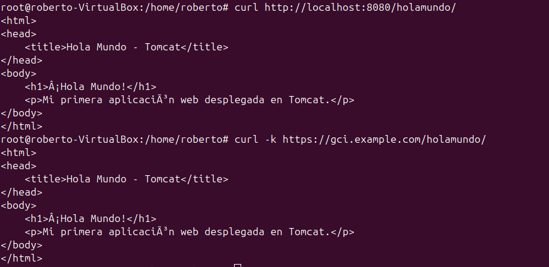
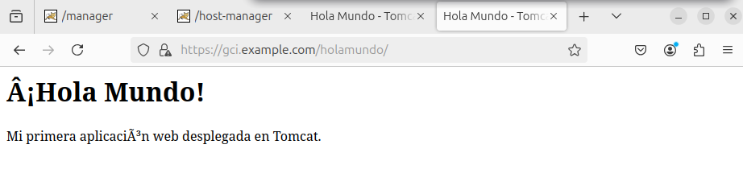

# Tomcat: Integración Tomcat + Servidor web

## 1. Comprobar Apache y Tomcat

Apache ya estaba instalado y configurado en la máquina virtual de una práctica anterior. Se ha comprobado el funcionamiento de Apache y Tomcat y se ha detenido Nginx para evitar conflictos con el puerto 80.

## 2. Configurar el Reverse Proxy

Se han habilitado los módulos `proxy` y `proxy_http` de Apache. Después, se han añadido las directivas `ProxyPass` y `ProxyPassReverse` al VirtualHost HTTPS de `gci.example.com` para reenviar las peticiones de `/holamundo/` a Tomcat, que escucha en el puerto 8080.

## 3. Verificar que la aplicación responde a través de Apache

Se ha comprobado el acceso a la aplicación mediante Apache utilizando `curl`. La respuesta contiene el HTML de la aplicación Hello World.

## 4. Acceder a la aplicación desde el navegador

Se ha accedido a `https://gci.example.com/holamundo/`. Apache recibe la petición HTTPS y la reenvía a Tomcat mediante el proxy inverso. La aplicación muestra correctamente el mensaje de bienvenida.

## Funcionamiento interno

1. El navegador envía una petición HTTPS a Apache.
2. Apache recibe la petición en el puerto 443.
3. Los módulos `proxy` y `proxy_http` reenvían la petición a Tomcat.
4. Tomcat recibe la petición en el puerto 8080 y procesa la aplicación.
5. Tomcat devuelve la respuesta a Apache.
6. Apache entrega el contenido al navegador mediante HTTPS.
