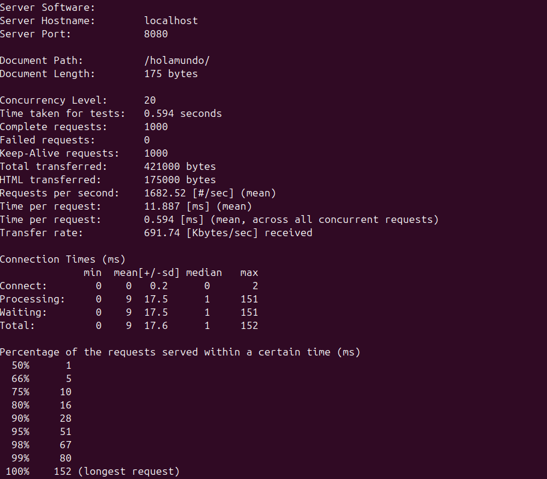
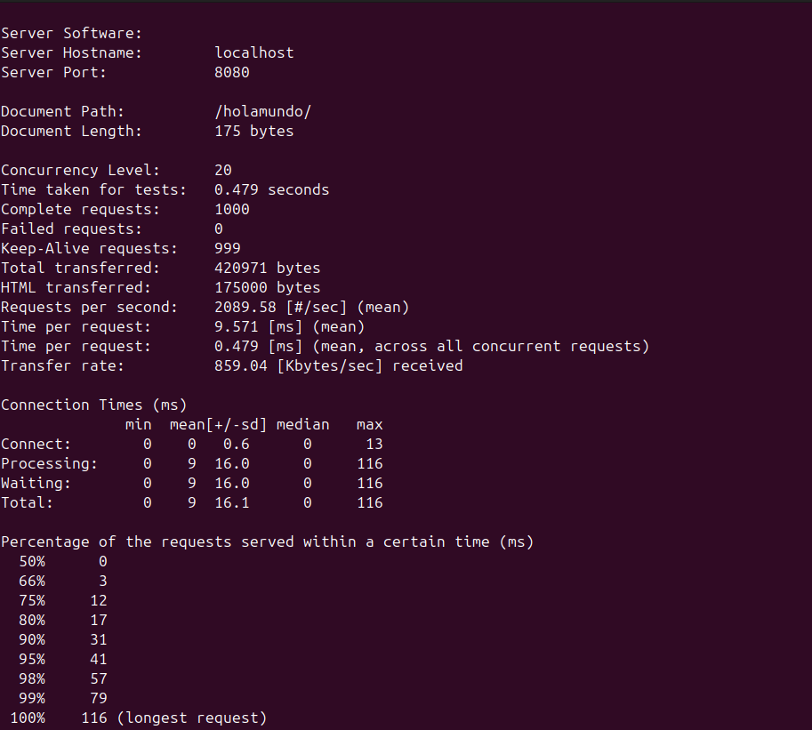

# Tomcat: Pruebas de funcionamiento y rendimiento

## 1. Instalar ApacheBench

ApacheBench (`ab`) es una herramienta que permite realizar pruebas de carga sobre un servidor web, simulando múltiples peticiones simultáneas y midiendo su rendimiento.

Se instala mediante el siguiente comando:

```bash
sudo apt update
sudo apt install apache2-utils -y
```

Se comprueba que está disponible:

```bash
ab -V
```

---

## 2. Realizar una prueba de carga inicial

Antes de modificar la configuración de Tomcat, se realiza una prueba de rendimiento sobre la aplicación `holamundo`.

Se utiliza la siguiente dirección:

`http://localhost:8080/holamundo/`

Se ejecuta ApacheBench con 1000 peticiones y 20 conexiones simultáneas:

```bash
ab -n 1000 -c 20 -k http://localhost:8080/holamundo/
```

Parámetros utilizados:

- `-n 1000`: número total de peticiones.
- `-c 20`: número de peticiones simultáneas.
- `-k`: mantiene las conexiones HTTP abiertas (Keep-Alive).

Se guardan los resultados para compararlos posteriormente:

```bash
ab -n 1000 -c 20 -k http://localhost:8080/holamundo/ > antes.txt
```

Entre los datos obtenidos destacan:

- Requests per second: peticiones atendidas por segundo.
- Time per request: tiempo medio de respuesta.
- Transfer rate: velocidad de transferencia.
- Failed requests: número de peticiones fallidas.



---

## 3. Modificar la configuración de Tomcat

Para ajustar el rendimiento se modifica el archivo principal de configuración:

```bash
sudo nano /etc/tomcat10/server.xml
```

Se localiza el conector HTTP que utiliza el puerto `8080` y se ajustan sus parámetros:

```xml
<Connector port="8080" protocol="HTTP/1.1"
           connectionTimeout="15000"
           maxThreads="250"
           maxConnections="10000"
           acceptCount="150"
           redirectPort="8443" />
```

Parámetros modificados:

| Parámetro | Función |
|---|---|
| `maxThreads` | Número máximo de hilos que pueden atender peticiones simultáneamente. |
| `maxConnections` | Número máximo de conexiones que puede aceptar el conector. |
| `acceptCount` | Número máximo de conexiones pendientes de ser atendidas. |
| `connectionTimeout` | Tiempo máximo de espera para recibir datos de una conexión, en milisegundos. |

Con estos valores se aumenta la capacidad de atención de peticiones simultáneas y se ajusta el tiempo de espera.

Se reinicia Tomcat para aplicar los cambios:

```bash
sudo systemctl restart tomcat10
```

Se comprueba que el servicio está funcionando:

```bash
sudo systemctl status tomcat10
```

---

## 4. Realizar una segunda prueba de carga

Una vez modificada la configuración, se repite exactamente la misma prueba para poder comparar los resultados.

```bash
ab -n 1000 -c 20 -k http://localhost:8080/holamundo/
```

```bash
ab -n 1000 -c 20 -k http://localhost:8080/holamundo/ > despues.txt
```

Para consultar los resultados:

```bash
cat antes.txt
cat despues.txt
```

