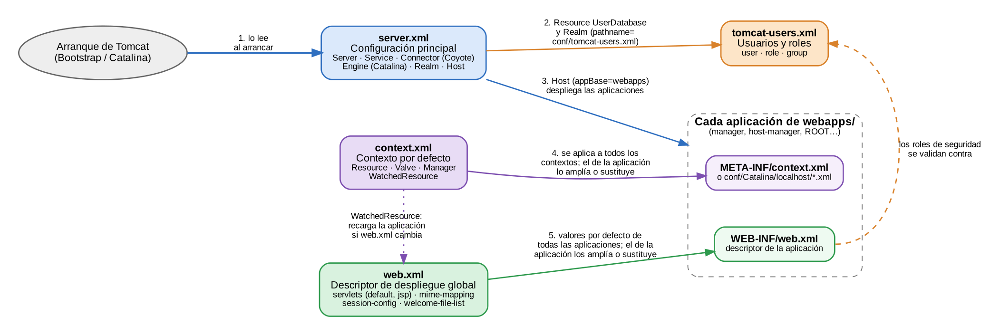

# Tomcat: identificación de archivos de configuración
 
## 1. Ubicación de los archivos
 
Tomcat se ha instalado con el paquete `tomcat10` de Ubuntu, que guarda la configuración en `/etc/tomcat10`. Los cuatro archivos clave de la carpeta `conf` están en estas rutas:
 
| Archivo (`conf/`) | Ruta en Ubuntu |
|---|---|
| `server.xml` | `/etc/tomcat10/server.xml` |
| `web.xml` | `/etc/tomcat10/web.xml` |
| `tomcat-users.xml` | `/etc/tomcat10/tomcat-users.xml` |
| `context.xml` | `/etc/tomcat10/context.xml` |
 
```bash
ls -l /etc/tomcat10/server.xml /etc/tomcat10/web.xml /etc/tomcat10/tomcat-users.xml /etc/tomcat10/context.xml
```
 
La carpeta `conf` de la instancia (`/var/lib/tomcat10/conf`) apunta a esa misma ubicación, por lo que son los mismos ficheros.
 
---
 
## 2. Función de cada archivo y elementos configurables
 
### 2.1 `server.xml`: configuración principal
 
Define la **estructura de Tomcat** y sus componentes: puertos, conectores, motor, hosts virtuales y autenticación. Es lo primero que lee Tomcat al arrancar, y los cambios solo se aplican reiniciando el servicio.
 
| Elemento | Qué configura |
|---|---|
| `Server` | Elemento raíz. Define el puerto de parada (8005) y su comando de cierre. |
| `Listener` | Componentes que reaccionan a eventos del ciclo de vida (registro de versiones, seguridad, prevención de fugas de memoria). |
| `GlobalNamingResources` | Recursos globales. Aquí se declara `UserDatabase`, que apunta a `conf/tomcat-users.xml`. |
| `Service` | Agrupa uno o varios conectores con un motor. |
| `Connector` | Es **Coyote**: puerto (8080), protocolo (`HTTP/1.1`), `connectionTimeout` y `redirectPort`. También permite activar HTTPS o AJP. |
| `Executor` | Grupo de hilos compartido por los conectores (opcional). |
| `Engine` | Es **Catalina**: `name="Catalina"` y `defaultHost="localhost"`. |
| `Realm` | Sistema de autenticación. `UserDatabaseRealm` utiliza el recurso `UserDatabase`. |
| `Host` | Host virtual: `name`, `appBase="webapps"`, `unpackWARs` y `autoDeploy`. |
| `Valve` | Componentes que procesan las peticiones en cadena, como `AccessLogValve`, que escribe el registro de accesos en `logs`. |
 
### 2.2 `web.xml`: descriptor de despliegue global
 
Contiene los **valores por defecto de todas las aplicaciones web** (configuración común). Cada aplicación puede tener su propio `WEB-INF/web.xml`, que amplía o sustituye a este.
 
| Elemento | Qué configura |
|---|---|
| `servlet` y `servlet-mapping` | Servlets y las URL que atienden. Los dos principales son `default` (sirve los ficheros estáticos) y `jsp` (el servlet de **Jasper**, asociado a `*.jsp` y `*.jspx`). |
| `filter` y `filter-mapping` | Filtros que se aplican a las peticiones. |
| `listener` | Clases que reaccionan a eventos de la aplicación. |
| `session-config` | Duración de las sesiones (`session-timeout`, 30 minutos por defecto) y cookies de sesión. |
| `mime-mapping` | Relaciona extensiones de fichero con tipos MIME. |
| `welcome-file-list` | Ficheros que se muestran al pedir un directorio (`index.html`, `index.htm`, `index.jsp`). |
| `error-page` | Páginas de error según código HTTP o excepción. |
| `security-constraint`, `login-config` y `security-role` | Protección de recursos con autenticación y roles (se usan en el `web.xml` de cada aplicación, como el de Manager). |
 
### 2.3 `tomcat-users.xml`: usuarios y roles
 
Es la **base de datos de usuarios, contraseñas y roles** (`UserDatabase`) que utiliza el `Realm` de `server.xml` para autenticar. Por defecto no hay ningún usuario activo (solo ejemplos comentados), por lo que hay que crear uno para usar Manager y Host Manager.
 
| Elemento | Qué configura |
|---|---|
| `role` | Declara un rol (`rolename`). |
| `user` | Define un usuario: `username`, `password` y los `roles` que tiene. |
| `group` | Agrupa roles y se asigna a usuarios (opcional). |
 
Roles que utilizan las aplicaciones de administración: `manager-gui`, `manager-script`, `manager-jmx` y `manager-status` (Manager), y `admin-gui` y `admin-script` (Host Manager). Las contraseñas se guardan en texto plano salvo que se configure un `CredentialHandler` con cifrado.
 
### 2.4 `context.xml`: configuración de contexto por defecto
 
Define la **configuración por defecto de cada contexto** (cada aplicación web), que se aplica a todas ellas. Una aplicación puede tener la suya propia en `META-INF/context.xml` o en `conf/Catalina/localhost/<aplicación>.xml`.
 
| Elemento | Qué configura |
|---|---|
| `Context` | Elemento raíz. Atributos como `reloadable` (recarga automática de clases) o `crossContext`. |
| `WatchedResource` | Ficheros cuya modificación hace que se recargue la aplicación: por defecto `WEB-INF/web.xml`, `WEB-INF/tomcat-web.xml` y el `web.xml` global de `conf`. |
| `Resource` | Recursos JNDI, por ejemplo una conexión a base de datos (*DataSource*). |
| `Manager` | Gestión y persistencia de las sesiones. |
| `Valve` | Filtros de la petición, como `RemoteCIDRValve`, que restringe el acceso por dirección IP. |
| `Environment` y `Parameter` | Variables y parámetros de configuración para las aplicaciones. |
 
---
 
## 3. Mapa visual de dependencias
 

 
**Lectura del mapa:**
 
1. Al arrancar, Tomcat lee **`server.xml`**, que define toda la estructura.
2. `server.xml` declara el recurso `UserDatabase` (con `pathname="conf/tomcat-users.xml"`) y un `Realm` que lo usa; por eso depende de **`tomcat-users.xml`** para autenticar.
3. El elemento `Host` de `server.xml` (`appBase="webapps"`) despliega las aplicaciones de `webapps/`.
4. **`context.xml`** se aplica a todos los contextos. Cada aplicación puede ampliarlo o sustituirlo con su propio `META-INF/context.xml` o un fichero en `conf/Catalina/localhost/`.
5. **`web.xml`** da los valores por defecto a todas las aplicaciones. El `WEB-INF/web.xml` de cada aplicación los amplía o sustituye, y los roles que exige (`auth-constraint`) se comprueban contra los usuarios de `tomcat-users.xml`.
6. `context.xml` incluye `WatchedResource` apuntando a los `web.xml`: si cambian, la aplicación se recarga.
